# 효과 목록 B: @mrcreates.ai 새 레퍼 2편 (프레임 분석)

## 방법

- 원본: `ScreenRecording_11-04-2026 15-00-11_1.MP4`(26.2s), `ScreenRecording_11-04-2026 15-00-54_1.MP4`(47.6s). 둘 다 1170×2532, 60fps, 화면 녹화. 손대지 않음.
- ffmpeg 10fps 전체 + 전환 구간 15~30fps 띠. 인스타 UI(상단 바, 좋아요 줄, 캡션)는 뺐다.
- 음성: whisper-cli base.en 으로 받아 적음. 시각은 녹화 기준 초. 이징은 프레임 간격으로 본 추정치.
- 썸네일 50장: `fx-thumbs/mrcreates-sound-NN-*.jpg`, `fx-thumbs/mrcreates-stack-NN-*.jpg` (180px).

## 두 릴스 정체

| | 릴스 A «Sound design takes HOURS» | 릴스 B «Your videos. AI slop?» (The Motion Stack) |
|---|---|---|
| 계정 | @mrcreates.ai (DM 공유로 열람, 상단 «Sent a message») | @mrcreates.ai (프로필 Posts 에서 열람) |
| 화면 제목 | 머리띠 «MR / SOUND DESIGN» + 장 탭 «01 FIND · 02 PLACE · 03 CHECK» | 장 칩 «1 STYLE BASE» → «2 MOTION PLAYBOOK» → «3 QUALITY CHECK» |
| 게시 캡션 첫 줄 | «Your Claude edits look polished, but they…» | «Better AI videos start before you hit Generate…» |
| 반응(녹화 시점) | ♥340 · 댓글365 · 리포스트12 · 공유222 | ♥142 · 댓글175 · 리포스트5 · 공유65 |
| 주제 | Claude 영상 편집에 효과음 붙이는 무료 도구 3개 (Openverse, Real SFX, Earshot) | AI 영상이 «슬롭»처럼 보이는 이유와 3층 구조 (스타일 베이스 · 모션 플레이북 · 품질 검사) |
| 배경 | 흰 바탕 + 아주 옅은 모눈. 22.2s 부터 검정 바탕 | 흰 바탕 + 옅은 모눈. 34.4~44.9s 만 검정 바탕 |
| 색 | 검정 글자, 포인트 파랑 (UI 버튼 실측 #2358E2), 주황 별(Claude 로고 계열, 값 확인 안 됨), 데모 카드 베이지 | 같은 파랑 하나 + 검정·흰. 다른 색 없음 |
| 글꼴 | 굵은 기하 산세리프 제목 + 좁은 세리프 이탤릭 파랑 부제. 글꼴 이름 확인 안 됨 | 같음 |
| 아바타 | 흑백 선화 안경 쓴 남자 얼굴(계정 주인 캐릭터). 처음 가운데 크게 → 장면 2부터 오른쪽 아래 작게, 커서로도 씀 | 같은 아바타. 처음부터 왼쪽 아래 작게, 장면마다 자리 이동, 커서 겸용 |
| 음성·자막 | 남성 내레이션, 빠름. 하단 가운데 3~6단어 묶음 자막, 지금 읽는 단어만 파랑 | 같음 |
| 길이·장면 | 26.2s, 장면 6개 (녹화가 «finds every moment» 에서 끊김. 뒤는 확인 안 됨) | 47.6s, 장면 11개 (끝 «stay consistent» 까지) |

### 받아 적은 말 (whisper)

- A: «Pro editors spend hours on sound design. Here's how Claude does it in minutes. For free. Claude can't hear, so it just guesses where the sound goes. These three free tools fix that, and the last one gives Claude actual ears. First, Openverse. It's a free library of over 5 million sounds, and Claude can search it without an API key. But a library is useless if Claude doesn't know where each sound belongs. That's where Real SFX comes in. It's a free Claude Code skill that finds every moment…»
- B: «Your Claude videos look like slop because you are skipping three layers. Master these three layers and everything changes. It's called the motion stack and it has three layers. Layer one is the style base… subject, lighting, color look… Layer two is the motion playbook… slow pushes, orbit shots, handheld drifts with the exact prompt wording… Layer three is a quality check… warped hands, flickering textures, movement that feels floaty. Then regenerate only what fails… Put the three together and your AI videos stay consistent.»

## 공통 틀 (두 편 모두)

화면은 위에서 아래로 다섯 칸으로 고정된다. 장 표시(탭 또는 칩), 두 줄 제목(산세리프 검정 1줄과 세리프 이탤릭 파랑 1줄), 가운데 그림 한 개, 아바타, 단어 강조 자막. 장면이 바뀌어도 칸 위치는 그대로라 눈이 헤매지 않는다. 제목 두 줄은 늘 «사실. 반전/약속.» 짝이다 (Looks right. / Sounds… off., Different clips. / Different feel.).

## 릴스 A 효과 (mrcreates-sound)

| # | 이름 | 영상·시각 | 무엇이 어떻게 움직이나 | 길이·이징 | 무엇을 말하나 | 만들기 메모 | 썸네일 |
|---|---|---|---|---|---|---|---|
| A01 | 단어 강조 자막 | A 0.5~끝 | 하단 자막 3~6단어 묶음이 흐림+투명에서 들어오고, 말하는 단어만 검정→파랑. 묶음 끝나면 흐림으로 빠짐 | 묶음 진입 0.15s, 단어 바뀜 0.2~0.4s 간격, 즉시 전환 | 귀로 듣는 말을 눈으로 따라가게 | 단어별 span, 음성 타임스탬프로 `tl.set(w,{color:blue},t)`; 묶음은 `from({filter:'blur(6px)',opacity:0},.15)` | 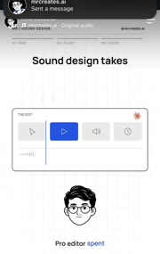 |
| A02 | 카드 기울기 정착 | A 0.9~1.3 | 편집기 카드가 약간 회전(-4°)·원근 기운 상태로 나타나 평평하게 돌아옴. 같은 순간 버튼 강조가 첫 칸으로 되감김 | 0.35s, power3.out | «이 편집기를 다시 시작한다» 리셋 | `from(card,{rotationZ:-4,rotationX:8,transformPerspective:800,duration:.35,ease:'power3.out'})` | 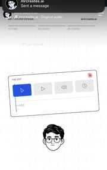 |
| A03 | 글자 물결 상승 (흐림) | A 2.0~2.3 «HOURS.» | 큰 굵은 글자가 한 글자씩 아래(+30px)·흐림·옅은 회색에서 올라와 자리. 앞 글자 먼저, 마지막 마침표가 끝. 들어오는 동안 기준선이 물결처럼 휜다 | 글자당 0.2s, 간격 0.03s, power2.out | 핵심 숫자/단어 한 방 | SplitText chars, `from({y:30,opacity:0,filter:'blur(8px)',stagger:.03,duration:.2})` | 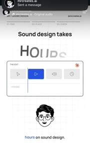 |
| A04 | 버튼 순환 + 재생선 | A 0.5~3.4 | 카드 안 버튼 4개(선택·재생·소리·시계)에 파란 채움이 0.5s 마다 오른쪽으로 옮겨 가고, 세로 재생선이 천천히 오른쪽으로 | 칸당 0.5s, 계단식(steps) | «편집 중» 상태가 살아 있음 | `tl.to(hl,{x:i*w,duration:.12},i*.5)` + 재생선 `to(x,{duration:3,ease:'none'})` | 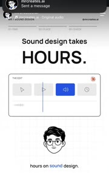 |
| A05 | 파형 자라기 | A 3.4~3.6 | 카드 아래 빈 줄에 파란 파형 막대가 왼→오로 차오름 | 0.25s, linear | 소리가 들어왔다 | 막대 div 수십 개, `from(bars,{scaleY:0,stagger:.005,transformOrigin:'50% 50%'})` | 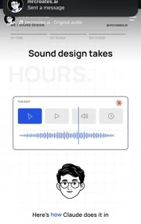 |
| A06 | 단어 교체 HOURS→MINUTES | A 3.5~3.95 | HOURS 가 회색으로 바래며 흐려져 사라지고(0.2s), 같은 자리에 MINUTES 가 파랑으로 A03 물결로 올라옴 | 나감 0.2s power1.in, 들어옴 0.25s | 전/후 대비, 시간 단축 | 같은 슬롯 두 span. 나감 `to({opacity:0,filter:'blur(8px)',color:'#bbb'})` → A03 | 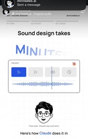 |
| A07 | 알약 배지 팝 | A 4.6~4.8 «3 FREE TOOLS» | 아바타 머리 위에 파란 알약이 흐림+작게에서 커지며 등장 | 0.2s, back.out(1.6) 추정 | 숫자 약속 하나 붙이기 | `from(pill,{scale:.6,opacity:0,filter:'blur(4px)',ease:'back.out(1.6)'})` | 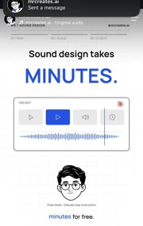 |
| A08 | 작은 단서 문구 | A 3.8~5.3 | 아바타 아래 아주 작은 회색 «Free tools · Claude may cost extra» 가 조용히 페이드 | 0.3s | 과장 방지 단서 | 9~10px 회색, `from({opacity:0})` | 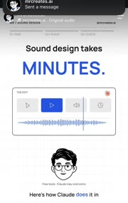 |
| A09 | 줌 관통 교차 전환 | A 5.35~5.7 | 옛 장면(제목·카드)이 살짝 커지며(1.0→1.05) 흐려지고, 새 카드가 아래에서 겹쳐 올라오고 별이 가운데에 먼저 나타남. 두 장면이 0.2s 겹침 | 0.35s, power2.inOut | 장면 바뀜을 부드럽게, 끊김 없이 | 두 장면 레이어, `to(old,{scale:1.05,opacity:0,filter:'blur(6px)'})` 와 `from(new,{y:40,opacity:0},'<.1')` | 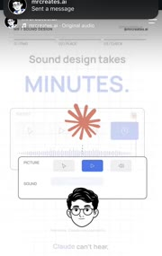 |
| A10 | 아바타 축소·모서리 이동 | A 5.4~5.8 | 가운데 큰 아바타가 크기 1→0.45 로 줄며 오른쪽 아래로 미끄러짐. 이후 장면 내내 그 자리 | 0.4s, power3.inOut | 훅 끝, 화자 → 해설자로 | `to(avatar,{x:..,y:..,scale:.45})` | 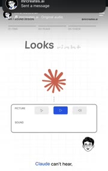 |
| A11 | 별 천천히 회전 + 점선 연결 | A 5.6~8.4 | 주황 별(Claude 표시)이 아주 느리게 돎(2s 에 약 15°, 프레임 비교로 확인). 별 아래 세로 점선이 카드와 이음 | 계속, linear | «Claude 가 이걸 본다» | `to(star,{rotation:'+=360',duration:40,ease:'none',repeat:-1})` + `border-left:2px dotted` | 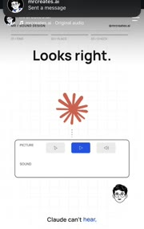 |
| A12 | 세리프 이탤릭 부제 흐림 진입 | A 6.5~6.8 «Sounds... off.» | 제목 아래 파랑 세리프 이탤릭이 단어별로 흐림·아래에서 올라옴. 마지막 단어가 기울게 뒤따라 | 단어당 0.15s, 간격 0.08s | 반전 한 줄 | 단어 split, `from({y:12,opacity:0,filter:'blur(6px)',stagger:.08})` | 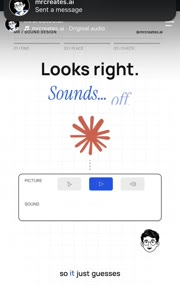 |
| A13 | 어긋난 파형 «Wrong moment» | A 6.7~8.4 | SOUND 줄에 파형이 흐림에서 진해지며 나타나는데 재생선(점선)과 중심이 어긋남. 오른쪽 아래 작은 파랑 «Wrong moment» | 0.3s, 진입 후 정지 | 틀린 자리를 그림으로 | 파형 `from({opacity:0,filter:'blur(6px)'})`, 위치를 일부러 재생선에서 비켜 둠 | 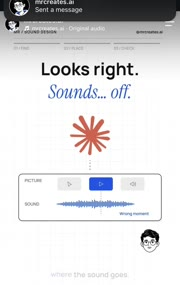 |
| A14 | 흐름 상자 차례 등장 | A 8.5~9.3 | 상자 3개(Openverse→Real SFX→Earshot)가 왼쪽부터 흐림에서 나타나고 사이 화살표가 뒤따름. 아래 작은 회색 «Find · Place · Check» | 상자당 0.15s, 간격 0.25s | 세 단계 지도 | `from(nodes,{opacity:0,filter:'blur(6px)',x:-8,stagger:.25})` | 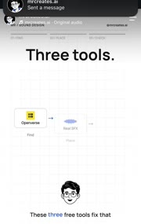 |
| A15 | 상자 차례 채움 | A 10.2~11.0 | 흰 테두리 상자가 하나씩 파랑으로 채워지며 살짝 위로(−3px) 뜸. 말(«and the last one gives») 박자에 맞춤 | 칸당 0.1s 채움, 간격 0.3s | 진행도, 하나씩 해결 | `to(node,{backgroundColor:blue,color:'#fff',y:-3,stagger:.3,duration:.1})` | 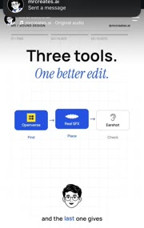 |
| A16 | 곡선 선 그리기 | A 11.0~11.3 | 마지막 상자 아래에서 파란 얇은 곡선이 아래 왼쪽으로 그려 내려와 다음 문장을 가리킴 | 0.3s, power2.out | 이 도구가 결론 | SVG path `strokeDashoffset` 길이→0 | 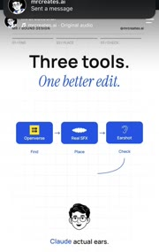 |
| A17 | 타자 한 줄 | A 11.4~11.9 «Give your agent ears.» | 굵은 검정 한 줄이 글자 단위로 왼→오 찍힘. 커서 없음 | 약 0.5s, 글자당 25ms | 핵심 문장 강조 | `tl.to(el,{text:str,duration:.5,ease:'none'})` (TextPlugin) | 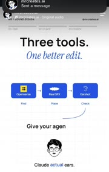 |
| A18 | 스크린샷 겹쳐 밀어 넣기 | A 12.35~12.6 | 실제 사이트 화면(Openverse 검정 홈) 판이 0.96→1 로 커지며 흐름 장면 위에 반투명으로 겹쳐 들어오고 옛 장면은 흐려짐 | 0.25s, power2.out | «이게 그 도구다» 실물 증거 | `from(shot,{scale:.96,opacity:0})` 와 old `to({opacity:0,filter:'blur(4px)'},'<')` |  |
| A19 | 장 탭 채움 | A 12.5 (01 FIND), 18.6 (02 PLACE) | 머리 아래 탭 3칸 중 현재 칸 글자가 파랑, 밑줄 막대가 차오름 | 0.3s | 지금 몇 단계인지 | 탭 3개 + 밑줄 `to(bar,{scaleX:1,transformOrigin:'left'})` | 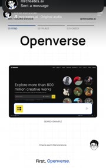 |
| A20 | 검색창 타자 | A 14.6~15.1 «soft click» | 스크린샷 속 검색창에 글자가 하나씩 찍힘 | 0.5s, 글자당 50ms | 쓰는 법 시연 | 스크린샷 위에 흰 입력 칸 덮고 TextPlugin | 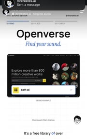 |
| A21 | 결과 카드 차례 팝 + 선택 | A 15.5~16.3 | 카드 3장(Click·Footsteps·Rain, 각 파형)이 왼쪽부터 흐림에서 나타나고 첫 장이 파랑으로 채워져 «선택됨» | 장당 0.15s, 간격 0.2s, 채움 0.1s | 검색 결과, 고른 것 | `from(cards,{opacity:0,y:8,filter:'blur(4px)',stagger:.2})` + `to(cards[0],{bg:blue})` | 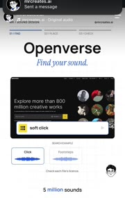 |
| A22 | 아바타 커서 | A 16.6~17.9, 19.8~21.6 | 모서리 아바타가 흰 원 테+작은 화살표 달린 커서로 바뀌어 UI 위를 이동(검색창 → 카드 사이). 멈출 때 살짝 커짐 | 이동 0.3~0.4s, power2.inOut | «Claude 가 직접 고른다» | 아바타 래퍼에 `::after` 화살표, `to(cursor,{x,y,duration:.35})` + `to({scale:1.1,yoyo:true,repeat:1,duration:.1})` | 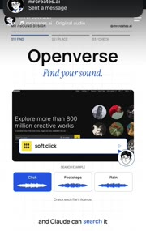 |
| A23 | 타임라인 조각 순환 | A 18.6~22.0 | «YOUR MOTION» 카드: 동작 칸 3개(CLICK·SWIPE·LAND) 파랑 강조가 옮겨 가고, 아래 파형 조각들이 각 동작 눈금 점선 위에 붙어 있음 | 칸당 0.5~0.7s, 계단식 | 소리가 동작 순간에 붙는다 | A04 와 같은 틀 + 파형 조각 absolute 배치 | 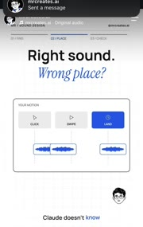 |
| A24 | 흰→검정 바탕 반전 | A 22.05~22.4 | 흰 장면이 회색으로 어두워지며(0.1s) 흐려지고 검정 바탕에 새 제목 «Real SFX» 가 흰 글자 물결로 올라옴 | 0.3s, power1.inOut | 장 바뀜, 분위기 전환 | 배경 `to(bg,{backgroundColor:'#111',duration:.3})` + 옛 장면 opacity 0 | 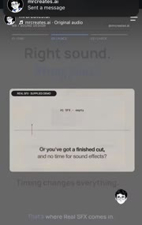 |
| A25 | 데모 카드 안 파형 폭발 + 라벨 | A 22.4~24.3 | 베이지 카드(«REAL SFX · SUPPLIED DEMO»): 가로선 위 눈금 하나 → 주황 파형이 가운데서 양옆으로 터지듯 퍼짐 → 위에 «real-sfx» 굵은 글자 흐림 진입 | 파형 0.3s expo.out, 라벨 0.2s | 도구가 하는 일 한 장면 | 파형 `from({scaleX:0,scaleY:.2,transformOrigin:'center',ease:'expo.out'})` | 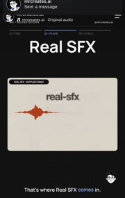 |
| A26 | 카드 안 타자 + 목록 생성 | A 24.6~26.2 | 카드 안 문장 «A library of real recorded sounds,» 가 단어별 흐림 진입, 동시에 파형이 축소돼 왼쪽 첫 칸으로 가고 소리 파형 5개가 차례로 생김 | 단어 0.12s, 파형 간격 0.15s | 소리 목록이 쌓인다 | 단어 stagger + 파형 `from({scaleX:0,transformOrigin:'left',stagger:.15})` | 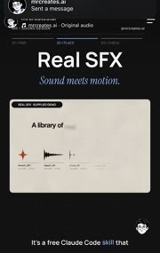 |

A25·A26 은 도구 회사가 준 데모 영상을 카드 안에 그대로 넣은 것으로 보인다(카드 위 «SUPPLIED DEMO» 표시). 직접 만든 모션인지는 확인 안 됨.

## 릴스 B 효과 (mrcreates-stack)

| # | 이름 | 영상·시각 | 무엇이 어떻게 움직이나 | 길이·이징 | 무엇을 말하나 | 만들기 메모 | 썸네일 |
|---|---|---|---|---|---|---|---|
| B01 | 세리프 이탤릭 기울어 들어오기 | B 1.3~1.9 «AI slop?» | 파랑 세리프 이탤릭 글자가 흐림·아래·약간 기울어진(글자마다 회전 다름) 상태에서 바로 섬 | 0.4s, 글자 간격 0.03s | 훅의 아픈 질문 | chars `from({y:20,rotation:()=>gsap.utils.random(-12,12),filter:'blur(6px)',opacity:0,stagger:.03})` | 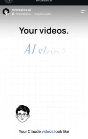 |
| B02 | 제목 통째 교체 | B 2.7~3.2 | «Your videos. / AI slop?» 가 흐려지며 위로 빠지고 «3 missing» 이 A03 물결로 들어옴. 이후 «layers.» 이탤릭 | 나감 0.2s, 들어옴 0.3s | 질문 → 답 | 제목 슬롯 하나, 나감 `to({y:-10,opacity:0,filter:'blur(6px)'})` | 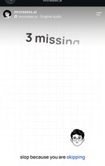 |
| B03 | 아이소 판 3장 차례 등장 | B 3.3~3.9 | 얇은 3D 직육면체(선화) 3장이 엇갈린 각도로 흐림에서 나타남. 가운데 판은 옅은 파랑→진한 파랑으로 채워짐 | 판당 0.2s, 간격 0.12s, 채움 0.4s | «층이 세 개» | SVG 아이소 상자 3개, `from({opacity:0,y:15,filter:'blur(5px)',stagger:.12})` + 가운데 fill 트윈 | 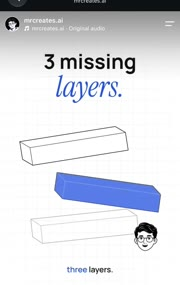 |
| B04 | 판 바로 서며 쌓기 | B 4.5~4.9 | 엇갈린 판들이 회전 0 으로 돌아오고 사이 간격이 줄며 하나의 탑으로 겹쳐짐. 크기는 약간 작아짐 | 0.4s, power3.inOut | 흩어진 것이 체계가 된다 | `to(slabs,{rotation:0,x:0,y:(i)=>i*h,scale:.8,duration:.4})` | 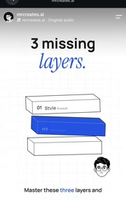 |
| B05 | 판 라벨 타자 | B 4.8~5.4 | 각 판 앞면에 «01 Style base / 02 Motion playbook / 03 Quality check» 가 위에서부터 단어 흐림 진입 | 줄당 0.2s, 간격 0.15s | 층 이름 | 단어 stagger, 파란 판 글자는 흰색 |  |
| B06 | 작은 이탤릭 꼬리말 | B 6.3~7.3 «Everything changes.» | 탑 아래 작은 파랑 세리프 이탤릭이 흐림 진입, 다음 장면 전에 흐림 퇴장 | 0.25s | 약속 한 마디 | B01 축소판 | 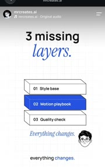 |
| B07 | 장 번호 칩 | B 9.0 / 21.7 / 34.4 | 왼쪽 위 검정 사각 숫자(1·2·3)+작은 대문자 장 이름이 바뀜 | 0.2s 페이드 | 지금 몇 장 | 고정 칩, 텍스트만 교체 `tl.set` + opacity | 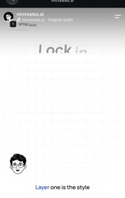 |
| B08 | 아이콘 원 차례 팝 | B 10.8~11.6 | 원형 아이콘 3개(주제·조명·색)가 왼쪽부터 흐림·작게에서 커짐 | 개당 0.15s, 간격 0.2s, back.out | 고정할 세 가지 | `from(icons,{scale:.7,opacity:0,stagger:.2,ease:'back.out(1.7)'})` | 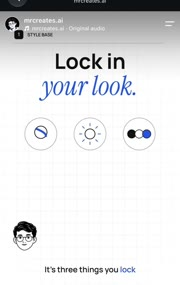 |
| B09 | 커서 탭 + 트리 연결 | B 13.5~15.6 | 아바타 커서가 원을 하나씩 누름 → 누른 원 테두리 파랑, 아래 라벨(Subject 등) 등장, 원에서 세로선이 내려와 가운데 결과 상자로 모이는 갈고리 선 | 원당 0.6s, 선 그리기 0.2s | 셋이 모여 한 결과 | 커서 이동 + `to(ring,{borderColor:blue})` + SVG 선 dashoffset | 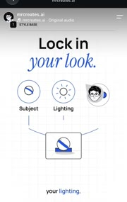 |
| B10 | 카드 부채 흩어짐 | B 15.6~16.3 | 결과 상자가 세 장 카드로 갈라져 각각 다른 각도(−6°, +3°, +5°)·높이로 흩어짐. 카드마다 그림 모양·명암이 다름 | 0.4s, power2.out | «클립마다 느낌이 다르다» 문제 | 3장 겹쳐 두고 `to(cards,{x:[-..,0,..],rotation:[-6,3,5],y:[10,-10,15]})` | 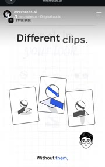 |
| B11 | 부채 → 정렬 + 체크 | B 19.7~20.4 | 기운 카드들이 회전 0·같은 높이로 줄 서고 그림이 똑같아짐. 아래 파란 점이 체크 표시로 바뀜(왼→오) | 정렬 0.3s, 체크 간격 0.1s | 해결 후 모습 | `to(cards,{rotation:0,y:0})` 다음 점→체크 스왑 stagger | 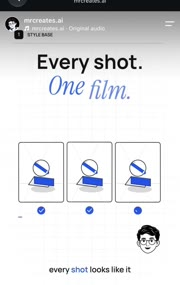 |
| B12 | 밑줄 그리기 + 한 줄 | B 20.2~21.0 | 카드 줄 아래 파란 가로선이 왼→오로 그려지고 «One visual language.» 가 단어 흐림 진입 | 0.4s, power2.out | 결론 표 | `from(line,{scaleX:0,transformOrigin:'left'})` | 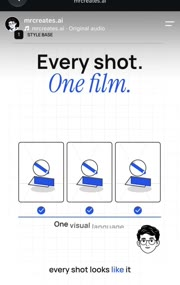 |
| B13 | 행 차례 공개 | B 23.6~24.3 | 목록 3행(카메라 아이콘+이름 왼쪽, 미리보기 카드 오른쪽)이 위에서부터 흐림 진입 | 행당 0.2s, 간격 0.2s | 목록 하나씩 | `from(rows,{opacity:0,y:10,filter:'blur(4px)',stagger:.2})` | 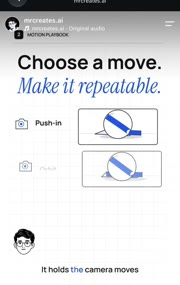 |
| B14 | 미리보기 안 카메라 무브 반복 | B 25~34 | 행마다 작은 카드 속 물체가 그 이름대로 움직임. Push-in = 천천히 커짐, Orbit = 받침이 돌아 물체 각도 바뀜, Handheld = 작게 흔들림. 말하는 행만 아래 파란 밑줄 | 각 2~3s 반복, sine.inOut | 무브 이름을 보여 주기로 설명 | 카드 안 svg, `to(obj,{scale:1.15,repeat:-1,yoyo:true})` / `rotationY` / 작은 x,y wiggle | 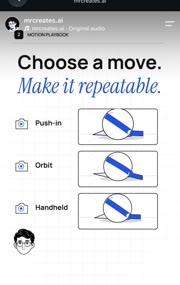 |
| B15 | 이탤릭 하위 라벨 | B 28.3~28.8 | 각 행 이름 아래 작은 파랑 이탤릭 «Slow push in / Orbit clockwise / Gentle drift» 가 위에서부터 흐림 진입 | 줄당 0.15s, 간격 0.15s | 정확한 프롬프트 문구 | B06 와 같은 틀, 작게 | 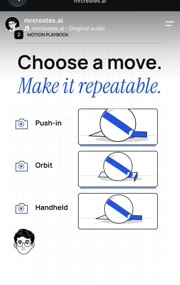 |
| B16 | 아바타 옆 한 줄 | B 31.0~34.3 «Build from what works.» | 아바타 오른쪽에 굵은 짧은 문장이 단어 흐림 진입 | 0.3s | 말풍선 없는 혼잣말 | 아바타 래퍼 옆 텍스트, 단어 stagger | 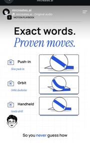 |
| B17 | 흰→검정 바탕 반전 | B 34.3~34.6 | A24 와 같음. 흰 장면이 회색으로 바래고 검정 바탕에 흰 제목 «Inspect it.» | 0.3s | 3장(검사)은 다른 방 | A24 재사용 | 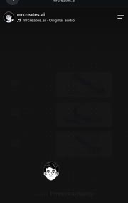 |
| B18 | 카드 차례 뒤집혀 켜짐 | B 35.9~36.6 | 회색 카드가 하나씩 흰 카드로 밝아지며 그림(손·줄무늬·물체) 드러남 | 장당 0.2s, 간격 0.2s | 검사 항목 셋 | `from(cards,{backgroundColor:'#555',opacity:.4,stagger:.2})` | 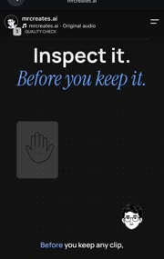 |
| B19 | 커서 검사 + «Look closer.» | B 36.8~40.2 | 아바타 커서가 카드 아래를 차례로 지나고, 지난 카드 오른쪽 위에 파란 점 배지, 아래 이름(Hands·Textures·Movement) 등장. 가운데 세리프 이탤릭 «Look closer.» | 카드당 약 1s | 하나씩 확인한다 | 커서 x 트윈 + 배지 `from({scale:0})` | 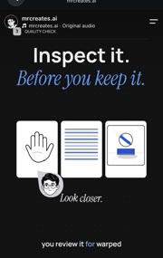 |
| B20 | 카드 어둡게 했다가 내용 바꾸기 | B 41.2~41.6 | 세 카드가 회색으로 어두워지는 사이 안 그림이 «결과 클립» 그림으로 바뀌고 다시 밝아짐. 제목도 같은 순간 «Keep the good.» 로 교체 | 0.4s (어둡게 0.15, 밝게 0.2) | 같은 자리에서 다음 단계 | `to(cards,{filter:'brightness(.5)'})` → 내용 swap → 되돌림 | 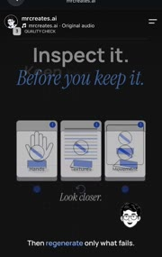 |
| B21 | 다시 만들기 회전 → 체크 | B 41.6~43.5 | 가운데 카드 아래만 체크 대신 회전 화살표. 커서가 누르면 카드 회색, 화살표 돎, 다시 밝아지며 체크로 | 회전 0.6s, 스왑 0.1s | «실패한 것만 다시» | `to(icon,{rotation:360,duration:.6})` 후 체크 svg 교체 | 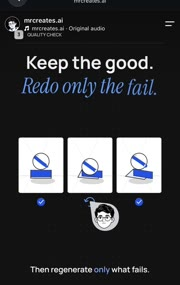 |
| B22 | 통과 밑줄 + 한 줄 | B 43.5~44.8 «Only approved clips.» | B12 와 같은 밑줄 그리기 + 굵은 한 줄 | 0.4s | 걸러진 결과 | B12 재사용 | 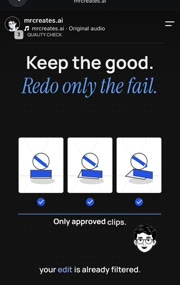 |
| B23 | 종이 세 장 합쳐 한 장 | B 44.8~45.8 | 검정이 회색으로 걷히며 카드가 빈 종이 3장(귀퉁이 접힌 문서)로 바뀜 → 흰 바탕에서 «01 Style / 02 Motion / 03 Quality» 종이가 가운데로 겹쳐 모이고 한 장의 결과 카드로 녹음 | 0.8s 전체, power3.inOut | 세 층을 합치면 하나 | 종이 3장 `to({x:0,rotation:0,opacity:(i)=>i==1?1:0})` + 결과 카드 crossfade | 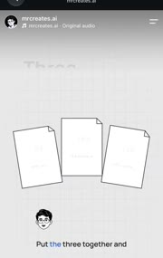 |
| B24 | 결과 카드 아래 한 단어 | B 46.3~47.6 «Consistent.» | 결과 카드 아래 뒤로 얇은 판 두 장이 비쳐 보이고(쌓인 느낌), 굵은 한 단어가 흐림 진입 | 0.25s | 마지막 도장 | 카드 뒤 offset 판 2장(opacity .3) + 단어 진입 | 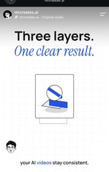 |

효과 수: A 26개 + B 24개 = 50개. 겹치는 것(단어 강조 자막, 흐림 진입, 아바타 커서, 흰→검정 반전)은 각 편에 한 번씩 셌다.

## 페이싱

**A (26.2s, 장면 6개, 녹화 끊김)**
1. 훅 5.4s 동안 한 장면: 제목 고정 + 큰 단어 하나만 HOURS→MINUTES 로 바꿔서 대비를 만든다. 장면 2부터 2.5~6s 마다 제목이 바뀐다.
2. 자막 단어는 0.2~0.4s 마다, 화면 속 무언가(버튼·파형·커서)는 0.5s 마다 움직인다. 정지 화면이 1s 를 넘지 않는다.
3. 장 탭(01·02·03)과 검정 바탕 반전으로 «세 도구 중 지금 몇 번째»를 말 없이 알린다.

**B (47.6s, 장면 11개)**
1. 장면 평균 4.3s. 장면마다 제목 두 줄이 먼저(0.3s) 서고, 그림은 그 다음 0.3~0.5s 안에 들어온다.
2. 그림 하나를 장면 사이에 들고 간다: 판 3장 → 탑 → 원 3개 → 카드 3장 → 정렬 카드 → 종이 3장 → 한 장. «셋»이 끝까지 같은 물건으로 이어진다.
3. 3장(검사)만 검정 바탕. 마지막 3s 에 흰 바탕으로 돌아와 셋이 하나로 합쳐지며 끝난다.

## 하마(돈 이야기)로 옮기면

- **A03·A06 글자 물결 + 단어 교체** → 숫자 대비. «$100/month» 가 회색으로 바래고 «$247,000» 가 파랑 물결로 올라온다(복리). 세금: «TAXED» → «TAX-FREE» (TFSA 상자).
- **A04·A05 버튼 순환 + 파형 자라기** → 적금 통장 화면: 월 칸 12개에 강조가 한 칸씩 옮겨 가고 잔액 막대가 차오른다.
- **A15 상자 차례 채움** → «월급 → 비상금 → TFSA → ETF» 순서도. 말 박자에 맞춰 하나씩 파랑으로.
- **A22·B09 아바타 커서** → 하마가 커서가 되어 영수증 줄을 짚거나 앱 버튼을 누른다. 하마 얼굴은 잘리지 않게 원 안에 통째로.
- **A24·B17 흰→검정 반전** → «돈이 새는 곳» 장만 검정. 해결 장면은 다시 버터 판으로.
- **B03·B04 판 쌓기** → 세금 상자 세 칸(TFSA·RRSP·FHSA)이 엇갈려 떨어졌다가 하나의 탑으로 선다.
- **B10·B11 부채 → 정렬 + 체크** → 흩어진 영수증 3장이 기울어 떨어졌다가 한 줄로 서며 체크. «정리 끝».
- **B14 미리보기 반복** → ETF 행 3개(VFV·XEQT·ZAG 같은 예시, 실제 상품명은 FACTS 확인 필요)마다 작은 차트가 각자 다르게 움직인다.
- **B21 회전 → 체크** → 비트코인 변동 카드 하나만 회전 화살표, 나머지는 체크. «떨어진 것만 다시 본다».
- **B23 종이 합치기** → 영수증·명세서·세금 서류 세 장이 한 장의 «올해 돌려받는 돈» 카드로 합쳐짐. 동전은 사진 scale 팝 대신 글자 숫자 쪽만 움직인다(모션은 글자만 원칙).

참고: «사진·물건 scale 팝 금지, 글자만 모션» 규칙은 2026-11-04 하림님이 폐기했다. B10·B23 처럼 물건이 움직이는 효과도 쓴다. 둥근 틀 안 하마 얼굴만 잘리지 않게 한다.

## 확인 안 됨

- 글꼴 이름 두 개, 주황 별 색 값.
- A 26.2s 이후 내용 (Earshot 장면, 끝 CTA).
- A25·A26 이 직접 만든 모션인지, 제공받은 데모 영상인지.
- 효과음: 녹화 오디오에 전환마다 짧은 효과음이 있는지는 따로 듣지 않았다.
