# 새 레퍼 3편 모션 전수 (@mrcreates.ai, 2026-11-04 녹화)

세 편 모두 @mrcreates.ai 릴스다. 같은 계정의 앞선 기록이 `fx-mrcreates.md`에 있어서 파일 이름은 fx-new-A 로 두었다. 시각은 녹화 파일 기준(초). 녹화 첫 0.6~0.8초는 아이폰 제어 센터라 뺐다. 방법: 10fps 전수 + 전환 구간 20~30fps, 음성은 whisper base.en. 본 것만 적었고 흐린 것은 '확인 안 됨'.

## 세 편 정체

| | A. edit30 | B. mcp5 | C. everyday |
|---|---|---|---|
| 파일 | `14-58-39_1.MP4` (32.1s) | `14-59-27_1.MP4` (24.1s, 5번째 도구 전에 녹화 끊김) | `15-02-01_1.MP4` (20.4s) |
| 계정 | @mrcreates.ai | @mrcreates.ai (좌상 «MR / CREATE WITH AI», 우상 «5 MCP CONNECTIONS») | @mrcreates.ai (상단 «MAKE ROOM FOR CREATING») |
| 화면 제목 | 고정 제목 없음. 첫 줄 «I turned Claude into my personal video editor.» | «Claude + five tools.» (상단 고정) | «Post. every day.» |
| 주제 | Claude 로 영상 편집, 스타일 4종, 자동 편집, 댓글 EDIT → 가이드 DM | 꼭 붙일 MCP 5개: Perplexity · Playwright · Firecrawl · HyperFrames · (5번 확인 안 됨) | 매일 올리려면 Claude Code 에 편집을 맡겨라. 이 영상 자체가 AI 편집. 댓글 CLAUDE |
| 바탕 | 미색 흰 바탕 + 옅은 모눈 + 가운데 파란 방사 글로우. 26~28s 만 검정 | 흰 모눈 → 16.3s 부터 남색(#12151F 근처) 다크 | 흰 바탕(모눈 없음). 11~13s 검정 |
| 색 | 파랑(#2F5BE3 근처) · Claude 코랄 · 노랑 · 검정 선화 | 파랑 · 코랄 · 도구 로고색 | 파랑 · 검정 · 코랄 로고 |
| 글꼴 | 산세리프(그로테스크) + 강조 단어만 세리프 이탤릭. 서체 이름 확인 안 됨 | 같음. «five tools.», «live» 등 세리프 이탤릭 파랑 | 큰 산세리프 볼드 제목 + 세리프 이탤릭 파랑 둘째 줄 |
| 캐릭터 | 안경 쓴 남자 얼굴 선화 아바타(머리만). 크게 가운데 → 작게 커서 역할 | 같은 아바타. 화면 속 커서 대신 손이 됨 | 같은 아바타. 가운데 크게 ↔ 구석 작게 |
| 자막 | 상단 한 줄 카라오케. 말한 단어가 하나씩 흐림→선명, 키워드는 옅은 파란 박스 + 세리프 이탤릭 | 상단 카라오케 동일 | 하단 카라오케. 줄은 다 보이고 지금 단어만 파란색 |
| 목소리 | 1인칭 남성 내레이션, 빠름 | 목록형 «One, Perplexity.» | «If you want to post a video every day…» |
| 장면 수 | 약 12 | 훅 1 + 도구 4(녹화분) | 약 9 |
| 반응(화면) | 좋아요 190 · 댓글 293 · 리포스트 4 · 공유 64 | 확인 안 됨 | 좋아요 302 · 댓글 964 · 리포스트 9 · 공유 136 · 저장 400 |
| 캡션 첫 줄 | «I used to spend 4 hours editing one reel. Now it takes one sentence…» | 확인 안 됨 | «The video you just watched was fully edited…» |

음성 받아쓰기(요약): A «I turned Claude into my personal video editor… No Premiere, no CapCut, no spending hours on a timeline. I just upload my footage and tell Claude what I want. Watch this. Make it futuristic. Now try a collage. Add motion graphics. Make it cinematic. Same footage, four completely different styles. It cuts out awkward pauses, finds the best moments, adds captions, and creates animations automatically… customize everything instead of using the same boring AI templates. Comment EDIT and I'll send you the guide.» B «Stop using Claude without these five MCPs. Here's what you're missing. One, Perplexity… Two, Playwright… Three, Firecrawl… Four, HyperFrames. It lets Claude create After Effects-style…» C «…Claude Code can now edit your videos for you. The video you're watching right now? Fully edited by AI. And no, it's not AI slop. You just tell it what you want, cuts, captions, sound effects… Comment Claude.»

## 효과 목록

### A. edit30 (32.1s)

| # | 이름 | 영상·시각 | 무엇이 어떻게 움직이나 | 길이·이징 | 무엇을 말하나 | 만들기 메모 | 썸네일 |
|---|---|---|---|---|---|---|---|
| A01 | 카라오케 키워드 박스 | A 1.6~31s 내내 | 상단 한 줄. 단어가 말과 함께 blur 8px·투명 → 선명. 키워드는 옅은 파란 사각 박스가 왼→오로 깔리고 글꼴이 세리프 이탤릭으로 바뀜. 문장 끝나면 줄 전체가 blur 로 사라짐 | 단어당 0.15~0.2s, power2.out | 지금 들리는 말 + 핵심 단어 | 단어 span 마다 `from({filter:'blur(8px)',opacity:0})`, 키워드 `::before` scaleX 0→1 origin left | 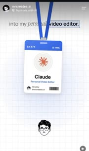 |
| A02 | 아바타 대기 + 방사 글로우 | A 0.8~2.8 | 가운데 큰 얼굴, 뒤에 옅은 파란 원형 글로우. 표정이 프레임마다 살짝 바뀜(입·눈썹) | 상시 | 화자 소개 | 얼굴 SVG 2~3장 교체 + `radial-gradient` 고정 |  |
| A03 | 로고 배지 + 링 펄스 | A 2.0 | 얼굴 오른쪽 위에 Claude 로고 원이 scale 0→1 로 튀고 분홍 링이 바깥으로 번짐 | 0.3s, back.out(2) | «Claude» 단어와 동시 | `from({scale:0})` + 링 `to({scale:1.6,opacity:0})` | 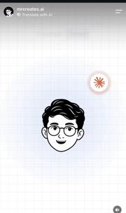 |
| A04 | 아바타 축소 하강 | A 2.7~2.9 | 큰 얼굴이 약 30% 크기로 줄며 화면 아래 1/4 로 떨어짐. 이후 이 자리가 아바타 정거장 | 0.2s, power3.in | 주인공 자리를 물건에게 넘김 | `to({scale:.3,y:'+=35vh'})` | 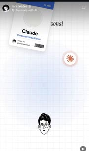 |
| A05 | 목걸이 사원증 낙하·흔들림 | A 2.8~3.4 | 파란 끈 달린 STAFF 카드가 화면 위 밖에서 −15° 기울어 떨어지고, 가운데 와서 좌우로 2번 흔들리다 멈춤 | 0.6s, 낙하 power2.in + 흔들림 elastic.out(1,.4) | «personal video editor» 고용 | `from({y:-800,rotation:-15})` 후 `to({rotation:0,ease:'elastic.out(1,.4)'})`, transform-origin 끈 꼭대기 |  |
| A06 | 로고가 사진 칸으로 날아듦 | A 3.2~3.6 | 오른쪽 위 로고 원이 사원증 사진 칸으로 이동하며 커져 들어앉음 | 0.3s, power2.inOut | 배지 주인 = Claude | FLIP: 로고 위치 → 사진 칸 좌표 `to({x,y,scale:1.4})` | 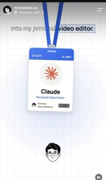 |
| A07 | 배지 위로 퇴장 + 모달 상승 | A 4.0~4.4 | 사원증이 위로 빠져나가고 «Go back to manual editing?» 확인창이 아래에서 올라와 자리 잡음 | 0.35s, power3.out | 예전 방식으로 돌아갈래? | 배지 `to({y:-900})`, 모달 `from({y:60,opacity:0})` 0.1s 겹침 | 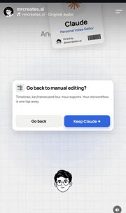 |
| A08 | 탭 파문 + 버튼 취소선 | A 5.0~5.4 | 작은 아바타가 «Keep Claude» 버튼으로 이동, 탭하면 원형 파문이 퍼지고 «Go back» 글자에 빨간 취소선 | 파문 0.3s, expo.out | 돌아가지 않는다 | 파문 원 `from({scale:0,opacity:.6})`, 취소선 `scaleX 0→1` |  |
| A09 | 독 아이콘 걷어차기 | A 5.8~6.2 | 앱 독(Pr·CapCut·Claude). 아바타가 사선 속도선을 끌고 떨어져 Pr 아이콘을 치면 회색 연기 뭉치가 되고 사라짐 | 0.4s, power4.in 충돌 | «No Premiere» | 아바타 `from({x:-120,y:-200})` + 대시선 3줄, 아이콘 → 연기 SVG crossfade | 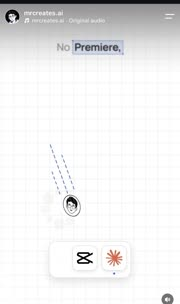 |
| A10 | 아이콘 뽑아 올리기 | A 6.4~7.0 | 아바타가 CapCut 아이콘을 물고 위로 끌어올려 독 밖으로 빼냄. 독엔 Claude 하나만 남고 독 폭이 줄어듦 | 0.5s, back.in 후 power2.out | «no CapCut» | 아이콘 `to({y:-120})`, 독 width 트윈 | 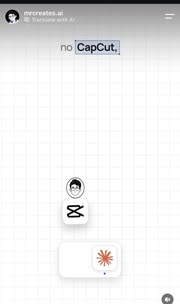 |
| A11 | 시계 부채꼴 + 시간 카운터 | A 7.0~8.4 | 아날로그 시계 바늘이 빠르게 돌고, 지나간 각만큼 파란 부채꼴이 채워짐. 아래 노란 칩 «0h 00m → 5h 20m on a timeline» 숫자가 같이 올라감 | 1.4s, linear 바늘 + 칩 숫자 snap | 타임라인에 버린 시간 | conic-gradient 각 트윈 + `textContent` 카운터 | 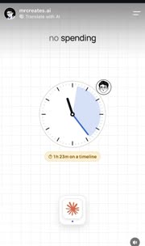 |
| A12 | 사진 격자 등장·선택 | A 8.6~9.4 | 빈 시트가 뜬 뒤 «Recents» 격자 6칸이 채워지고, 아바타가 속도선 끌고 와서 한 칸을 노란 배경 + 파란 테두리로 선택 | 0.6s, stagger 0.05 | «I just upload» | 칸 stagger `from({scale:.9,opacity:0})`, 선택 칸 배경 트윈 | 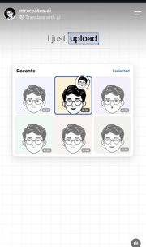 |
| A13 | 공유 시트 상승 | A 9.4~10.0 | 아래에서 «Share to» 시트(Claude·Save·Copy·More)가 올라오고 체크가 선택 칸에 찍힘 | 0.3s, power3.out | 업로드 → Claude 에 넘김 | `from({yPercent:100})` |  |
| A14 | 음성 파형 → Sent 알약 | A 10.2~10.8 | 공유 시트가 Claude 카드로 변신, 빨간 녹음 점 + 파형 막대가 오른쪽으로 자람. 끝나면 파형 바가 파란 알약으로 채워지며 «Sent» | 0.6s, linear 파형 + power2.out 채움 | 말로 지시한다 | 막대 N개 scaleY 랜덤 반복, 끝에 배경 파랑 트윈 |  |
| A15 | 3D 커버플로 스타일 전환 | A 11.0~15.4 | 원근 걸린 카드 줄(Original · Futuristic · Collage · Motion graphics · Cinematic). 키워드마다 줄 전체가 왼쪽으로 한 칸 밀리고, 가운데 카드는 정면·크게, 양옆은 rotateY ±35°로 접힘 | 칸당 0.3s, power3.inOut | 같은 소스, 다른 스타일 | 컨테이너 `perspective:900px`, 카드 `rotateY`, `z` 를 인덱스 차이로 계산 |  |
| A16 | 커버플로 → 부채 펼친 손패 | A 15.4~16.0 | 줄이 가운데로 모이며 4장이 겹쳐진 손패(각 −12°~+12° 회전, 살짝 기울어진 평면)로 접힘 | 0.4s, power2.inOut | «Same footage, four styles» | 각 카드 `to({x:i*40,rotation:-12+i*8,rotateX:20})` | 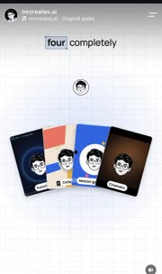 |
| A17 | 체크리스트 순차 체크 | A 18.0~22.8 | «Edit checklist» 카드 4줄. 말에 맞춰 아바타 커서가 한 줄씩 내려가며 체크박스를 파랗게 채움. 우상 칩 «0/4 → 4/4 done», 4/4 에서 초록 | 줄당 0.2s 체크, back.out | 자동으로 해 주는 일 4가지 | 체크 `from({scale:0})`, 칩 숫자 교체 + 색 트윈 | 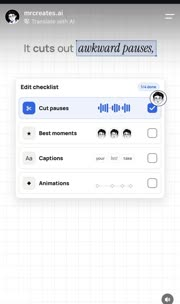 |
| A18 | 줄 안 미니 그래픽 | A 18.8~22.6 | 각 줄 오른쪽에 작은 그림: 파형 막대(컷), 얼굴 3개 중 가운데 강조(베스트), «your best take» 중 단어 박스(자막), 점 사이 곡선이 그려짐(애니메이션) | 각 0.3s | 각 기능을 그림 한 개로 | 곡선 `strokeDashoffset` 트윈, 얼굴 가운데 scale 1.2 | 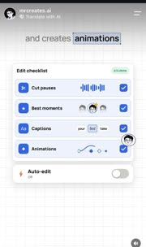 |
| A19 | 자동 편집 토글 | A 21.6~23.0 | 카드 아래 «Auto-edit Off» 줄이 슬라이드인, «automatically» 에서 스위치가 파랗게 켜지고 부제 «On · every new upload» | 0.25s, power2.out | 이제 자동 | 손잡이 `x` + 트랙 배경색 | 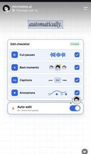 |
| A20 | 색·글꼴 순환 원 | A 23.4~25.2 | 큰 원 속 얼굴, 둘레를 Aa 칩과 색 점이 궤도처럼 둘러쌈. 원 색이 파랑→코랄→노랑→파랑, 아래 «Your style.» 글꼴이 산세리프→세리프 이탤릭→모노로 동시에 바뀜. 바뀔 때 해당 칩에 링 + 선이 이어짐 | 단계당 0.4s, steps 느낌 | 다 내 맘대로 | 원 배경색 타임라인 3키, 라벨 font-family 교체, 칩에 링 pop | 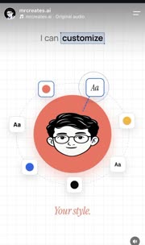 |
| A21 | 원 → 검은 구슬 | A 25.2~25.6 | 얼굴·칩이 흐려지고 원이 줄며 광택 있는 검은 3D 구슬이 됨(위 하이라이트, 아래 그림자) | 0.3s, power2.in | 분위기 반전 예고 | 원 `to({scale:.5,background:'radial-gradient(#555,#000)'})` + drop shadow | 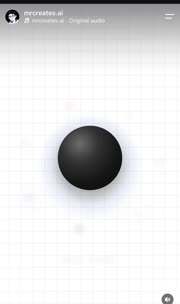 |
| A22 | 구슬 아이리스 → 다크 | A 25.6~25.8 | 검은 구슬이 순식간에 화면보다 크게 부풀며 가장자리가 흐린 검은 원이 다음 다크 장면을 드러냄 | 0.15~0.2s, expo.in | «instead of…» 나쁜 쪽 세계로 | 다음 장면 `clip-path:circle(0%→150%)`, 가장자리 blur 마스크 | 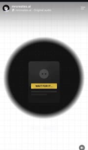 |
| A23 | 복붙 증식 격자 | A 25.8~26.8 | 다크 바탕에 «WAIT FOR IT…» 카드 1장 → 2 → 4 → 8 → 16. 아래 키캡 «⌘C ⌘V» 중 ⌘V 가 파랗게 눌리고 «+2 +4 +8 +16» 카운터. 카드는 겹쳤다가 격자로 정렬 | 단계당 0.2s, power2.out | 다 똑같은 템플릿 | 카드 clone 후 grid 위치로 `from` 겹침, 카운터 교체 | 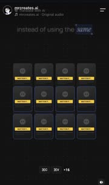 |
| A24 | 빨간 TEMPLATE 도장 | A 27.0~27.8 | «boring» 에 16장 위에 빨간 «TEMPLATE» 꼬리표가 한 장씩 찍히고, 이어 격자 전체가 어두워짐 | 0.4s, stagger 0.02 | 지루한 AI 템플릿 | 꼬리표 `from({scale:1.4,opacity:0})` stagger, 격자 opacity .4 | 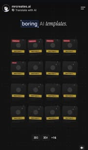 |
| A25 | 다크 → 밝음 복귀(흐린 얼굴) | A 27.8~28.2 | 검은 화면 가운데 흐린 얼굴이 떠오르고 곧 밝은 파란 그라데이션 + 반짝 별 바탕으로 바뀌며 큰 얼굴 | 0.3s, power2.out | 해결로 돌아옴 | 다음 장면 opacity + 얼굴 `from({filter:'blur(10px)'})` |  |
| A26 | 글자 타일 낙하 + 입력칸 | A 28.6~29.6 | 얼굴이 위로 작아지고 E·D·I·T 흰 타일이 하나씩 떨어짐. 위에 IG 입력칸이 뜨고 글자가 하나씩 입력될 때마다 해당 타일이 파랗게 | 타일당 0.1s, back.out | «Comment EDIT» | 기존 `fx-mrcreates` 41번과 같은 계열. 타일 `from({y:-60})` + 배경색 stagger | 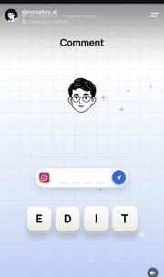 |
| A27 | 알약 변신 + 종이비행기 | A 29.6~29.9 | 입력칸이 파란 캡슐 + 빈 원으로 갈라지고, 종이비행기가 점선 꼬리를 그리며 오른쪽 위로 날아감. 타일들은 기울며 흩어짐 | 0.3s, power2.in | 보냈다 | 비행기 `motionPath` + 점선 `strokeDashoffset` | 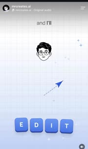 |
| A28 | 고리 경로 → DM 알림 카드 | A 30.0~30.8 | 점선이 8자 고리를 그리며 내려와 IG 알림 카드가 됨. «sent you the guide ✨» + PDF 썸네일이 옆에서 들어오고 빨간 1 배지 pop | 0.6s, power2.out | 가이드가 DM 으로 온다 | 경로 draw 후 카드 `from({scale:.9,opacity:0})`, 배지 back.out | 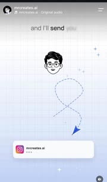 |
| A29 | 프로필 링 그리기 + 핸들 타이핑 | A 31.0~31.8 | 얼굴 둘레에 IG 그라데이션 링이 한 바퀴 그려지고, 아래 커서가 «@mrcreates.ai» 를 한 글자씩 입력, 마지막에 선택 박스 | 0.8s, linear 타이핑 | 팔로우하라 | 링 `strokeDashoffset`, 글자 `steps()` |  |
| A30 | 팔로워 카운터 | A 31.8~32.1 | 핸들 아래 «posts · followers · following» 줄, 팔로워 숫자가 올라가며 멈춤(47,176 → 56,040 프레임 확인) | 0.3s+, power2.out | 이만큼 따른다 | `gsap.to(obj,{v:56040,onUpdate})` |  |

### B. mcp5 (24.1s)

| # | 이름 | 영상·시각 | 무엇이 어떻게 움직이나 | 길이·이징 | 무엇을 말하나 | 만들기 메모 | 썸네일 |
|---|---|---|---|---|---|---|---|
| B01 | 고정 제목 + 상단 카라오케 | B 0.6~5.0 | 제목 «Claude + five tools.»(산세리프 + 파란 세리프 이탤릭)은 안 움직이고, 그 위 한 줄 카라오케만 바뀜. 첫 장면은 전체가 blur 에서 선명 | 진입 0.3s | 표지 문장을 그대로 잡아 둠 | 제목 정적, 자막은 A01 재사용 |  |
| B02 | 도구 아이콘 줄 팝 | B 3.2~3.6 | «these five» 에 아바타가 아래로 비키고, 아이콘 5개가 왼쪽부터 하나씩 흐린 사각 → 선명하게 pop | 개당 0.08s, back.out | 다섯 개 | stagger 0.08 `from({scale:.6,opacity:0})` | 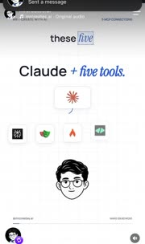 |
| B03 | 가지 연결선 그리기 | B 3.6~3.9 | Claude 로고 타일에서 아래 5 아이콘으로 곡선 5개가 위에서 아래로 자라남 | 0.3s, power2.out | 다 Claude 에 꽂힌다 | SVG path `strokeDashoffset` 동시 | 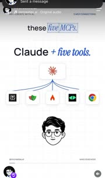 |
| B04 | 파란 알약 blur 등장 | B 4.2~4.6 | 아이콘 아래 흐린 회색 막대가 선명한 파란 알약 «Here's what you're missing» 으로 | 0.3s | 다음 예고 | `from({filter:'blur(6px)',opacity:0,scaleX:.8})` |  |
| B05 | 5칸 진행 막대 + 큰 번호 | B 5.2~ 끝 | 장면이 바뀌며 상단에 5칸 진행 막대, 현재 칸이 파랗게 차 있음. «01 Perplexity» 큰 얇은 숫자 + 로고. 다음 도구마다 칸이 하나씩 참 | 칸 채움 0.3s | 지금 몇 번째 | 칸 `scaleX 0→1`, 숫자는 교체 |  |
| B06 | 입력칸 타이핑 | B 5.8~6.6 | 빈 입력칸에 커서가 깜빡이고 «Find the latest product updates» 가 한 글자씩 | 0.8s, steps | 실제 사용 장면 | `steps(n)` 또는 글자 span stagger |  |
| B07 | 결과 줄 순차 등장 | B 6.6~7.8 | 아바타가 전송 버튼에 원형 커서 링을 대고, 아래로 결과 카드 3줄(Latest update found · Product documentation · Release notes)이 위에서부터 차례로 | 줄당 0.2s, power2.out | 실시간 검색 결과 | stagger 0.2 `from({y:-8,opacity:0})` |  |
| B08 | 선택 박스 + 모서리 손잡이 | B 9.0~9.8 | 첫 결과 줄에 파란 테두리 + 네 모서리 핸들이 생기고 나머지 줄은 흐려지며 사라짐, 선택 줄만 위로 | 0.3s | 이걸 쓴다 | outline 박스 `from({scale:1.08,opacity:0})`, 나머지 opacity 0 |  |
| B09 | 답 카드 안으로 끼워넣기 | B 10.0~10.4 | 선택 줄이 «Answer with source context» 카드 안 자리로 이동해 박힘 | 0.3s, power2.inOut | 답에 출처가 붙는다 | FLIP 이동 |  |
| B10 | 커서 고무줄 선 | B 12.4~15.0 | 아래 아바타에서 화면 속 목표(입력칸·버튼)까지 가는 직선이 늘었다 줄었다 하며 따라감. 끝에 작은 화살표 | 상시 | Claude 가 브라우저를 직접 만진다 | 선 끝 좌표를 목표에 묶어 매 프레임 갱신 | 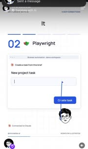 |
| B11 | 체크 + 버튼 → Created ✓ | B 14.4~15.4 | «Add to today's list» 체크가 찍히고, «Create task» 를 누르면 파란 버튼이 옅은 테두리 «Created ✓» 로 바뀜. 아래 칩 «Click → type → complete» | 0.25s | 일이 끝났다 | 버튼 배경·글자 crossfade | 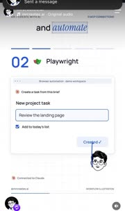 |
| B12 | 카드 확장 다크 전환 | B 16.2~16.5 | 흰 장면 속 브라우저 카드가 먼저 남색으로 바뀌고, 그 카드가 사방으로 커져 화면 전체를 덮어 다크 모드가 됨 | 0.25s, power3.in | 3번부터 다른 세계 | 카드 `clip-path:inset()` 0 으로, 또는 FLIP scale 로 전체화면 |  |
| B13 | 줄 스캔 하이라이트 | B 17.6~19.2 | «A page full of information.» 페이지의 회색 줄들이 커서가 훑는 대로 위에서부터 한 줄씩 파랗게 칠해짐 | 줄당 0.15s | 페이지를 긁어 온다 | 줄 `scaleX 0→1` 파란 덧막대, stagger |  |
| B14 | 페이지 → JSON 변형 | B 19.2~19.6 | 칠해진 페이지가 흐려지며 같은 창 안에서 «Extracted content · JSON» (title/summary/source) 으로 바뀜. 우하에 «Ready for the workflow» | 0.3s crossfade | 쓸 수 있는 데이터가 됨 | 두 레이어 opacity 교차 + 약한 blur |  |
| B15 | 기울어진 블록 착지 | B 21.8~22.2 | «Make this headline move.» 입력 뒤 파란 «MAKE IT MOVE.» 블록이 뒤로 기울고 흐린 채 나타나 정면으로 세워지며 선택 핸들이 붙음 | 0.3s, back.out | 글자에 모션을 준다 | `from({rotateX:25,rotation:-4,scale:.9,filter:'blur(4px)'})` | 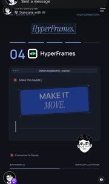 |
| B16 | 키프레임 곡선 그리기 | B 22.4~23.6 | 블록 아래 타임라인에 점 5개가 찍히고 그 위로 부드러운 곡선이 왼→오로 그려짐. 세로 재생선이 따라감 | 1s, linear | 애프터이펙트식 그래프 | path draw + 점 stagger | 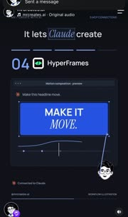 |
| B17 | 출처 칩 등장 | B 23.6~23.9 | 창 아래 «Ae After Effects-style motion» 칩이 흐림에서 선명 | 0.2s | 한 줄 결론 | B04 와 같은 방식 | 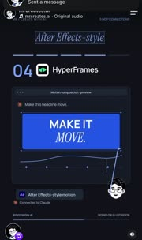 |

### C. everyday (20.4s)

녹화 0~0.8s 에 «Post.» 가 반쯤 올라오다 끊기고 다시 시작한다. 릴스가 되감긴 것으로 보이나 확인 안 됨. 아래 시각은 0.9s 재시작 기준.

| # | 이름 | 영상·시각 | 무엇이 어떻게 움직이나 | 길이·이징 | 무엇을 말하나 | 만들기 메모 | 썸네일 |
|---|---|---|---|---|---|---|---|
| C01 | 마스크 상승 2단 제목 | C 0.9~1.3 | «Post.» 굵은 산세리프가 아래 마스크 선 밑에서 올라오고, 0.1s 뒤 «every day.» 파란 세리프 이탤릭이 같은 방식으로 | 줄당 0.25s, power3.out | 표지 문장 | 줄 wrapper `overflow:hidden`, 글자 `from({yPercent:100})` |  |
| C02 | 요일 칸 사이 카드 뜀 | C 1.0~2.2 | MON·TUE·WED 칸이 왼쪽부터 생기고, 파란 재생 카드가 칸에서 칸으로 살짝 기울며 뛰어 옮겨 감. 지난 칸엔 회색 01·02 이탤릭 숫자 | 칸당 0.35s, power2.inOut + 회전 ±6° | 매일 하나씩 | 카드 x 트윈 + 중간 `rotation:6, y:-10` | 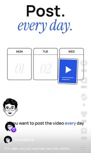 |
| C03 | 하단 줄 카라오케 | C 내내 | 아바타 옆 한 줄 자막이 처음부터 다 보이고 지금 말하는 단어만 파란색으로 옮겨 감. 줄 교체 때 흐린 회색에서 시작 | 단어당 0.15s | A01 보다 조용한 자막 | 단어 span color 를 시간표대로 교체 | 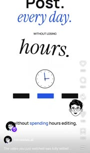 |
| C04 | 시계 + 막대 + 취소선 | C 2.4~3.8 | 칸이 흐려지고 작은 시계(바늘 회전)와 검정·파랑·검정 막대 3개. «WITHOUT LOSING» 작은 대문자 아래 «hours.» 세리프 이탤릭이 마스크 상승, 곧 가로 취소선이 왼→오로 그어짐 | 취소선 0.3s, power2.out | 시간을 안 잃는다 | 취소선 `scaleX 0→1` origin left | 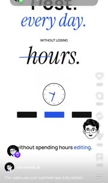 |
| C05 | 아바타 줌인 + 밑줄 | C 4.2~4.6 | 장면이 비고 아바타가 가운데 막대에서 크게 확대되어 나옴. «Watch this.» 의 this 아래 파란 밑줄이 그어짐 | 0.3s, back.out | 이 영상을 봐라 | 아바타 `from({scale:.4,y:80})`, 밑줄 scaleX |  |
| C06 | 로고 회전 등장 + 제목 교체 | C 5.4~5.9 | «Watch this.» 가 위로 흐려지며 빠지고 아바타는 왼쪽 아래로 작아짐. 코랄 Claude 별 로고가 흐리게 회전하며 진해지고 «Claude Code» 제목이 마스크 상승 | 0.4s, power2.out | 주인공 등장 | 로고 `from({rotation:-90,opacity:0,scale:.6})` | 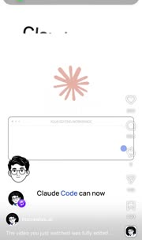 |
| C07 | 작업창 타이핑 + 연결선 | C 6.0~7.4 | 로고에서 아래 «YOUR EDITING WORKSPACE» 창으로 세로선이 내려오고 «Edit my video.» 가 흐림→선명으로 한 글자씩. 이어 «Tools connected. Ready to create.» 부제, 파란 점이 체크로 | 0.9s | 말로 시킨다 | 글자 blur stagger + 점 → 체크 교체 | 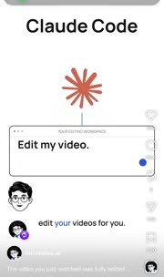 |
| C08 | 겹침 디졸브 변형(자기 참조) | C 8.0~8.3 | «Claude Code» 와 «This video.» 가 같은 자리에서 겹쳐 바뀌고, 작업창이 «CURRENT PROJECT» 창으로 바뀌며 안에 이 영상 첫 장면(Post. every day.) 축소판이 나타남 | 0.25s crossfade | 지금 보는 게 그 결과물 | 두 레이어 opacity 교차, 축소판은 C01 장면 재사용 scale .35 |  |
| C09 | 진행 막대 → 알약 | C 8.4~9.6 | 창 아래 3칸 진행 막대가 파랗게 차오르고, 다 차면 하나의 알약으로 뭉쳐 «Edited by AI.» 글자가 흐림에서 선명 | 1.2s, 채움 linear + 뭉침 power2.inOut | 완전 AI 편집 | 막대 width 트윈 후 border-radius·width 트윈 | 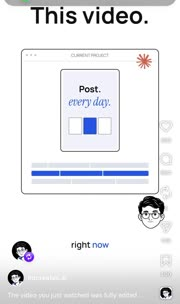 |
| C10 | 검정 컷 + 큰 얼굴 | C 10.9~11.3 | 창이 회색으로 바래며 작아지고, 화면이 검정으로 바뀌며 아바타가 크게 튀어나옴. 상단 «And no.» 흰 볼드 | 0.2s, 컷에 가까움 | 반론 차단 | 배경색 즉시 교체 + 얼굴 `from({scale:.7})` | 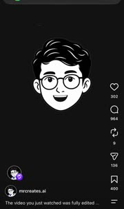 |
| C11 | AI slop 상승 + 취소선 | C 11.6~12.6 | 얼굴 아래 «AI slop.» 흰 세리프 이탤릭이 마스크 상승, 가운데로 가로선이 양쪽에서 그어짐 | 0.3s + 0.3s | AI 찌꺼기 아님 | C04 취소선 재사용 | 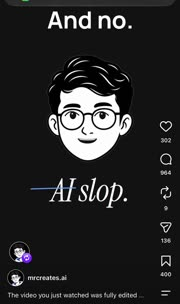 |
| C12 | 회색 경유 밝음 복귀 | C 12.8~13.2 | 검정이 회색으로 밝아지는 사이 얼굴이 위로 올라가며 흐려지고, 흰 장면의 프롬프트 칸이 겹쳐 보임 | 0.3s | 다시 방법으로 | 배경 #000→#888→#fff 키 3개 |  |
| C13 | 프롬프트 → 기능 줄 쌓기 | C 13.2~15.8 | «Make this a great video.» 타이핑 → 아바타 커서가 작은 Post 카드에 떨어짐 → 카드가 사라지며 «Cuts»(클립 블록 + 재생선) «Captions»(파란 «Your story.» 알약) «Sound effects.»(세리프 이탤릭 + 파형) 가 말에 맞춰 한 줄씩 왼쪽 정렬로 | 줄당 0.3s, power2.out | 시키면 이것들을 한다 | 줄 `from({x:-30,opacity:0})`, 오른쪽 그림은 0.1s 늦게 | 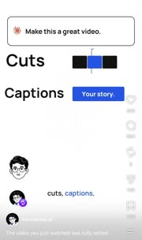 |
| C14 | 요소들이 카드로 모여 조립 | C 16.6~17.0 | 가운데 Post 카드가 나타나고, 세 줄의 오른쪽 그림(블록·알약·파형)이 카드 아래로 빨려들어 세로로 쌓임. 왼쪽 라벨은 흐려짐 | 0.35s, power3.inOut | 다 합쳐 한 편 | 각 그림 FLIP → 카드 아래 목표 좌표 | 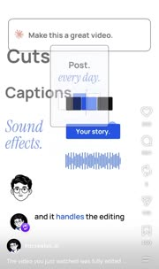 |
| C15 | 체크 배지 + 제목 | C 17.0~17.4 | 카드 우하 파란 점이 체크 배지로 바뀌고 «Made for you.» 파란 세리프 이탤릭 마스크 상승 | 0.2s, back.out | 나만의 결과물 | 점 → 체크 SVG 교체 + scale pop | 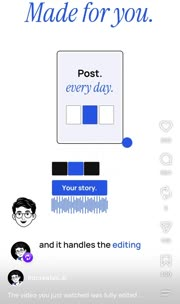 |
| C16 | Your turn 2단 | C 18.4~19.2 | 카드가 사라지고 큰 아바타 가운데, «Your turn.» 세리프 이탤릭 + «Try it yourself.» 산세리프가 차례로 마스크 상승 | 줄당 0.25s | 네 차례 | C01 재사용 |  |
| C17 | 말풍선 + 큰 키워드 | C 19.4~20.3 | 아바타가 오른쪽 위로 작아져 붙고, 그 자리에서 말풍선이 열림(꼬리 왼쪽 아래). 제목이 «Comment» 로 바뀌고 풍선 안 «CLAUDE» 파란 대문자가 흐림에서 선명하게 커짐 | 0.4s, back.out | 댓글 키워드 | 풍선 `from({scale:.8,transformOrigin:'0% 100%'})`, 글자 blur→0 | 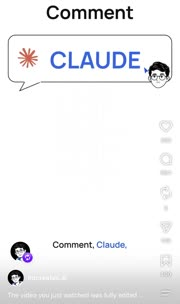 |

효과 64개(A 30 · B 17 · C 17).

## 편별 속도 메모

**A. edit30**
- 단어 하나가 장면 하나다. 2초 안에 그림이 한 번은 바뀌고, 새 물건이 들어올 땐 거의 늘 아바타가 커서처럼 날아와 건드린다.
- 밝음 22초 → 검정 2초(나쁜 세계) → 밝음 4초(CTA). 검정 구간은 구슬 아이리스로만 들어가 대비가 세다.
- 끝 6초를 CTA 에 쓴다. 타일·입력·비행기·DM·프로필·팔로워 숫자까지 한 줄로 잇는다.

**B. mcp5**
- 틀이 고정이다. 진행 막대·큰 번호·창 하나·아바타 커서. 도구마다 약 5초, 그 안에 입력 → 결과 → 선택 세 박자.
- 화면 글자는 적고 대신 창 안 UI 가 실제로 움직이며 기능을 보여 준다.
- 중간(16.3s) 한 번 다크로 뒤집어 늘어지는 목록에 리듬을 준다.

**C. everyday**
- 큰 2단 제목(산세리프 + 세리프 이탤릭)이 매 장면 바뀐다. 장면 길이는 1.5~3초.
- 자막은 하단 줄에 조용히 두고 그림 쪽 움직임은 적다. 취소선 두 번(hours · AI slop)이 반박 장치다.
- 자기 참조(이 영상이 증거) 뒤 검정 컷으로 반론을 막고, 줄 쌓기 → 한 카드로 조립하며 끝낸다.

## 하마(돈 이야기)로 옮기면

이 계정 소재(Claude·IG·사람 얼굴 아바타)는 가져오지 않는다. 움직임 방식만 빌린다. 하마 그림은 고정, 움직이는 건 글자·숫자·카드다(기존 규칙).

- **A11 시계 부채꼴 + 카운터** → 복리. 부채꼴 대신 해마다 채워지는 원, 칩 숫자(예: 월 적립액 → 몇 년 뒤 금액)가 같이 올라간다. 숫자는 원본 값만 쓴다.
- **A15 커버플로** → ETF 비교. 같은 $1,000 을 카드 4장(현금·적금·S&P ETF·비트코인)에 넣고 단어마다 한 칸씩 민다.
- **A16 손패 펼치기** → «돈 상자 4개» 한 장 요약. 저축 계좌 종류(TFSA·RRSP·FHSA·일반)를 손패로 쥔 모양.
- **A17 체크리스트 + x/4 done** → 연말 세금 체크. 줄마다 미니 그림(영수증·상자·도장), 4/4 에서 초록.
- **A23 복붙 증식** → 복리·반복 적립. ⌘V 대신 «+$50» 키캡을 누를 때마다 동전 카드가 2→4→8→16.
- **A24 빨간 도장** → 수수료·세금 경고. 카드 위에 «FEE», «TAX» 꼬리표가 하나씩 찍힌다.
- **B05 5칸 진행 막대 + 큰 번호** → «돈 새는 곳 5개» 같은 목록형 릴스의 고정 틀.
- **B13 줄 스캔 → B14 JSON 변형** → 영수증·명세서 읽기. 영수증 줄이 칠해지고 «항목·금액·공제 여부» 표로 바뀐다.
- **C04·C11 취소선** → 오해 깨기(«비트코인은 사기다», «적금이면 충분»).
- **C02 요일 칸 뜀** → 매주 자동 적립. 동전 카드가 MON→TUE→WED 로 뛰며 칸에 금액이 남는다.
- **C09 막대 → 알약** → 목표 달성. 저축 목표 막대가 다 차면 «목표 달성» 알약으로 뭉친다.
- **C14 요소 조립** → 포트폴리오 완성. ETF·현금·채권 블록이 한 상자로 빨려든다.
- **A22 아이리스 다크 전환** → «안 하면 이렇게 된다» 반대 세계로 들어갈 때 한 번만.
- **A30 카운터** → 마지막 결과 숫자 한 번. 과장 없이 원본 값으로만.

## 가장 쓸 만한 8개

1. A11 시계 부채꼴 + 시간 카운터: 복리·시간 이야기에 그대로 맞는다.
2. A15 3D 커버플로: 같은 돈, 다른 상품 비교.
3. A23 복붙 증식 격자: 반복 적립이 불어나는 그림.
4. A17 체크리스트 순차 체크: 세금·정리 목록, 저장을 부른다.
5. B05 5칸 진행 막대 + 큰 번호: 목록 릴스 고정 틀.
6. B13→B14 줄 스캔 → 데이터 변형: 영수증·명세서 읽기.
7. C01 마스크 상승 2단 제목 + C04 취소선: 표지 언어(산세리프 + 이탤릭)와 오해 깨기.
8. C14 요소가 카드로 모여 조립: 한 편의 결론 장면.
