# 효과 목록 — @mrcreates.ai 레퍼 4편 (프레임 분석)

## 방법

ffmpeg로 네 녹화의 전체 프레임을 10fps로 뽑아 2초 단위 대지로 봤고, 결제창 찢김·결제창 등장·아이소 스택 진입은 30fps로 한 번 더 봤다. 인스타 UI(상태 막대, 오른쪽 아이콘 줄, 캡션)는 뺐다. 시각은 각 녹화 기준 초다.

- V1 = `ScreenRecording_11-04-2026 13-15-04_1.mov` (14.3s, 훅 → 01 Desktop app → 02 One folder)
- V2 = `ScreenRecording_11-04-2026 13-15-29_1.mov` (9.3s, 02 → 03 Local chat → 04 Five tools)
- V3 = `ScreenRecording_11-04-2026 13-16-30_1.MP4` (18.8s, 10 Claude edits → 11 Feedback → 체크리스트 → 도구 vs 취향 → EDITOR CTA)
- V4 = `ScreenRecording_11-04-2026 13-18-29_1.mov` (7.9s, «Forget hashtags»)

PNG 3장(`IMG_5644`~`5646`)도 함께 봤다.

## _index.md 와 다른 점

- **hub 5/5:** 녹화에는 0/5까지만 나온다. 0/5→5/5로 차는 장면은 확인 안 됨. PNG 5644에 «Claude + five tools.» 표지만 있다.
- **도달 막대:** 92%에서 7%가 아니라 4%까지 떨어진다. 중간값은 91, 90, 87, 83, 78, 72, 64, 56, 46, 37, 29, 22, 16, 11, 8, 5, 4.
- **폴더 가지치기:** 두 녹화 사이에서 대부분 지나갔다. 보이는 건 Exports가 튀어나오는 마지막 한 칸뿐이다.
- **V1 왼쪽 회색 막대:** iOS 볼륨 표시라서 목록에서 뺐다. V3 18.1s의 재생 버튼도 인스타 일시정지 표시로 보고 뺐다.

## 효과 목록 (54개)

| # | 이름 | 영상·시각 | 무엇이 어떻게 움직이나 | 길이·이징 | 무엇을 말하나 | 만들기 메모 | 썸네일 |
|---|---|---|---|---|---|---|---|
| 1 | 단어 블러 등장 | 전편 (V1 1.6–1.9 등) | 자막 단어가 말하는 순서대로 하나씩 들어온다. 흐림 8px, 투명도 0→1, 세로 약 4px 위로. 줄이 끝나면 줄 전체가 흐려지며 사라진다 | 단어당 0.15–0.2s, power2.out | 말과 글을 맞춤 | `gsap.from(word,{filter:'blur(8px)',opacity:0,y:4,duration:.18})` | 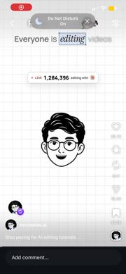 |
| 2 | 핵심어 선택 상자 | 전편 (V1 1.6 «editing», 2.9 «Claude») | 핵심어 한 개만 세리프 이탤릭으로 바뀌고, 연파랑 바탕에 파란 테두리 상자가 씌워진다. 오른쪽 아래 모서리에 점 하나가 붙어 피그마 선택처럼 보인다. 단어가 들어온 뒤 0.1s에 켜진다 | 0.12s, 바로 켜짐 | 이 단어를 기억하라 | 단어를 감싼 span에 `.sel` 클래스 추가 (outline과 배경색 전환) | 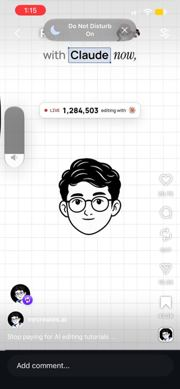 |
| 3 | LIVE 카운터 | V1 1.5–2.6 | «LIVE 1,284,099 editing with ✱» 칩. 숫자가 1,284,099에서 1,284,503까지 계속 올라가고 빨간 점이 깜빡인다 | 1.1s, linear 위에 불규칙한 tick | 지금 모두가 쓰고 있다 | `gsap.to(o,{v:503,snap:'v',onUpdate})`, 칩은 scale 0.9→1로 등장 | 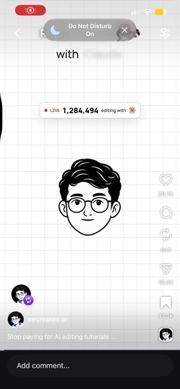 |
| 4 | 아바타 말하기·눈 깜빡임 | V1 0–2.9, V4 전편 | 가운데 선화 아바타의 입과 눈만 바뀐다. 몸은 고정 | 프레임 교체 약 0.1s | 내가 말한다 | 스프라이트 3장을 `steps()`로 교체 | 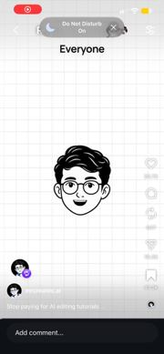 |
| 5 | 아바타 구석으로 축소 + 결제창 상승 | V1 3.0–3.5 | 아바타가 scale 1→0.3으로 줄며 살짝 기울고 왼쪽 위로 날아간다. 동시에 결제창 카드가 화면 아래(y+60%)에서 올라와 약간 넘쳤다가 자리를 잡는다. LIVE 칩은 흐려지며 사라진다 | 0.45s, back.out(1.2) | 반전: 그런데 사람들은 돈을 낸다 | 타임라인 한 개로 아바타 `{scale:.3,x,y,rotation:-8}`, 카드 `from {yPercent:120}` | 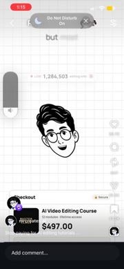 |
| 6 | «Setup locked» 원 펄스 | V1 3.6–3.9 | Secure 배지가 검은 «🔒Setup locked»로 바뀌고, 둘레에 얇은 원이 커지면서 사라진다 | 0.3s, expo.out | 잠겨 있다 | 원 `scale 0.6→1.6, opacity 1→0` |  |
| 7 | 가격 빨간색 | V1 4.7–5.2 | «$497.00»가 «course» 단어와 같이 검정에서 빨강으로 바뀌고, 0.5s 뒤 다시 검정으로 돌아온다 | 0.1s 바로 바뀜 | 가격이 함정이다 | `color` set → delay → set |  |
| 8 | 60 SECONDS 배지 팝 | V1 5.5 | 파란 원형 배지 «60 SECONDS»가 카드 오른쪽 위 모서리에 scale 0→1로 붙는다 | 0.2s, back.out(2) | 약속은 60초 | `from {scale:0}` |  |
| 9 | **결제창 찢김** | V1 6.53–7.05 | ① 결제창 가운데(가격 오른쪽)에서 파란 스파크가 번쩍인다. ② 세로 지그재그 금이 위에서 아래로 그어진다(약 0.1s). ③ 카드가 왼쪽 반과 오른쪽 반으로 갈라진다. 왼쪽은 −x로 가며 −6° 회전, 오른쪽은 +x로 가며 +8° 회전하고, 둘 다 아래로 떨어지기 시작한다. 찢긴 틈 뒤로 «THE WHOLE SETUP / Empty folder → finished reel» 카드가 이미 깔려 있는 게 보인다. ④ 두 조각이 더 기울며(약 ±20°) 화면 아래로 빠지고, 조각 가장자리는 흐려진다. 깊이감은 2D 회전뿐이고 3D는 없다 | 합계 약 0.5s. 금 0.1s, 벌어짐 0.15s power2.out, 낙하 0.25s power2.in | 비싼 강의를 찢는다, 그 대신 이것 | 카드를 `clip-path: polygon(지그재그)` 두 장으로 복제. L `{x:-40,rotation:-20,y:600}`, R `{x:40,rotation:22,y:650}` power2.in. 뒤 카드는 미리 깔아 둠 | 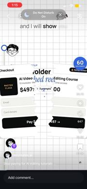 |
| 10 | 찢김 스파크 | V1 6.5–6.65 | 찢기는 지점에 파란 4각 별 1–2개가 scale로 번쩍인다 | 0.15s | 찢는 순간 강조 | SVG 별 `scale 0→1→0, rotation 45` | 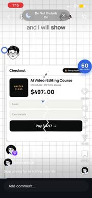 |
| 11 | 레일 따라 아바타 하강 | V1 7.0–7.5, V2 0.7·6.7, V3 0.5·4.6 | 왼쪽 세로 레일 맨 위에 파란 고리 노드가 뜬다. 작은 아바타 원이 레일을 따라 아래로 내려가고, 뒤에 파란 점선 꼬리가 남는다. 지나간 레일은 파랗게 찬다 | 0.4–0.5s, power1.in | 다음 단계로 간다 | 아바타 `y`를 tween하고, 꼬리는 `stroke-dasharray` 선을 늘림 | 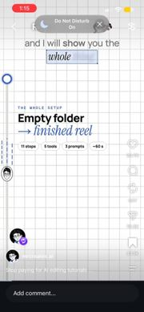 |
| 12 | **단계 전환 카메라 팬 + 단계 칩 상승** | V1 7.5–7.8, 11.9–12.3 / V2 0.7–1.3, 6.6–7.0 / V3 0.6–1.0, 4.6–5.1 | 장면 전체(카드와 자막)가 위로 스크롤되며 화면 밖으로 나간다. 새 단계 칩(«01 Desktop app», «02 One folder» 등)이 아바타와 함께 아래에서 올라와 위쪽 y≈13% 자리에 멈춘다. 컷 없이 세로 레일을 따라 카메라가 내려가는 느낌 | 0.4–0.5s, power3.inOut | 체크리스트 한 칸 전진 | 장면 컨테이너 `yPercent:-100`, 칩 `from {yPercent:400}` | 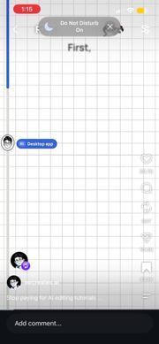 |
| 13 | 앱 카드 GET → 진행률 | V1 7.8–9.4 | Claude 앱 카드가 들어온 뒤 «GET» 버튼이 진행 막대로 바뀐다. 0, 1, 4, 9, 16, 26, 37, 50, 63, 74, 84, 91, 96, 99%로 연파랑 채움이 왼쪽에서 오른쪽으로 찬다 | 1.4s, power1.in(가속) | 설치 중 | 폭 tween과 숫자 snap | 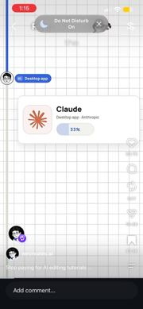 |
| 14 | 진행률 → OPEN 버튼 | V1 9.5 | 99%가 파란 «OPEN» pill로 한 번에 바뀐다 | 0.1s 바로 바뀜 | 설치 끝 | 배경색과 글자 set | 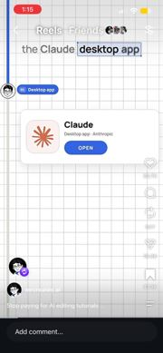 |
| 15 | 탭 리플 | V1 10.0–10.1 | OPEN 위에 얇은 원이 퍼진다(손가락 탭) | 0.2s, expo.out | 눌러라 | 원 `scale .5→1.4, opacity→0` | 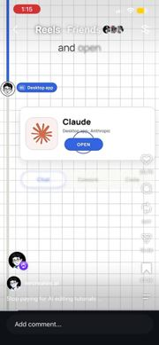 |
| 16 | 탭 전환 (pill 이동) | V1 10.0–10.8 | Chat · Cowork · Code 탭 줄이 흐림에서 선명하게 등장한다. 흰 선택 pill이 Chat에서 Code로 미끄러지고 Code 글자가 파래진다 | 0.25s, power3.inOut | Code 탭을 써라 | pill에 `x` tween (FLIP) | 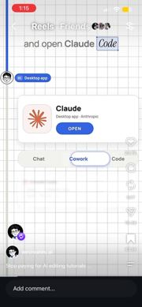 |
| 17 | 터미널 카드 블러인 + 타이핑 커서 | V1 10.7–11.4 | «Claude Code > ready · desktop app > local files: on» 카드가 흐림에서 선명하게 들어온다. 끝에 커서 █가 깜빡인다 | 0.2s + 깜빡임 0.5s 주기 | 준비 끝 | `from {filter:blur(6px),opacity:0}`, 커서는 `steps(1)` 반복 | 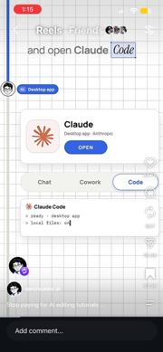 |
| 18 | 브라우저 칩 취소선 + 빨간 X | V1 11.3–11.8 | «claude.ai in a browser» 칩이 흐림에서 들어온다. 빨간 취소선이 왼쪽에서 오른쪽으로 그어지고 빨간 ⊗ 원이 pop한다 | 선 0.2s power2.out, X 0.15s back.out | 이건 아니다 | `::after`에 `scaleX 0→1`, origin left | 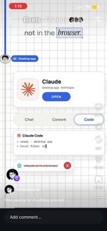 |
| 19 | 폴더 팝 | V1 13.1–13.3 | 파란 폴더 아이콘과 «New folder» 라벨이 scale 0.6→1로 튀어나온다 | 0.2s, back.out(1.7) | 폴더를 만든다 | `from {scale:.6,opacity:0}` | 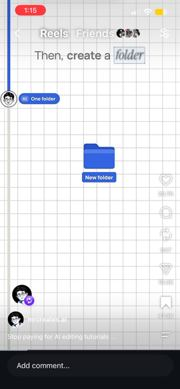 |
| 20 | «This computer» 태그 | V1 13.9 | 폴더 위에 작은 칩이 아래에서 위로 떠오르며 붙는다. 나중에 폴더 이름이 «AI Video Editor»로 바뀐다 | 0.15s | 내 컴퓨터에 | `from {y:6,opacity:0}` | 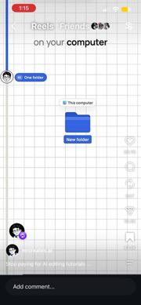 |
| 21 | 폴더 가지치기 | V2 0–0.6 | 부모 폴더 아래로 파란 T자 트리 선이 뻗고, 자식 폴더 3개(Raw Footage, References, Exports)가 차례로 팝한다. 녹화에 보이는 건 Exports 한 개뿐 | 자식당 0.15s, stagger 약 0.4s(말에 맞춤) | 폴더 구조 | 선 `scaleX/scaleY` draw, 자식은 `from {scale:0}` | 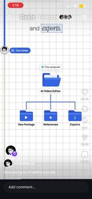 |
| 22 | Cloud/Local 토글 | V2 1.4–2.9 | 세그먼트 토글이 블러인으로 들어온다. «local» 단어가 나오는 순간 파란 pill이 Cloud에서 Local로 미끄러지며 커지고, Cloud는 회색이 된다 | 0.2s, power3.out | Local을 고른다 | pill `x`와 `width` tween | 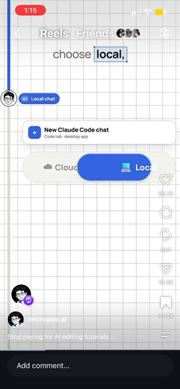 |
| 23 | 경로 타이핑 + 체크 | V2 3.3–3.9 | 입력칸에 `~/` → `~/Deskt` → `~/Desktop/AI Vid\|` → `~/Desktop/AI Video Editor` 순으로 글자가 타이핑된다. 끝나면 파란 ✓ 원이 팝하고 테두리가 파래진다 | 약 0.6s, 글자 단위 steps | 이 폴더를 연결 | TextPlugin 또는 substring steps, ✓는 back.out | 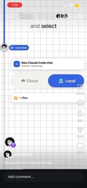 |
| 24 | «Claude can see» 스캔 광택 + Read/Write 칩 | V2 4.2–5.9 | 폴더 타일 3개 카드가 블러인으로 들어온다. «see» 단어에 맞춰 세로 파란 광택 띠가 타일을 왼쪽에서 오른쪽으로 훑고, 지나간 타일은 파란 테두리가 켜진다. 그 뒤 «✓Read», «✓Write» 초록 칩이 차례로 팝한다 | 광택 0.8s linear, 칩 0.1s 간격 | Claude가 파일을 읽고 쓴다 | 그라디언트 오버레이 `xPercent -100→200`, 타일은 테두리 class stagger | 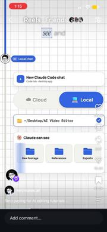 |
| 25 | hub 0/5 + 점선 궤도 | V2 7.0–9.3 | 주황 ✱ 카드가 작게 시작해 scale 0.7→1로 팝하고 «0/5 tools» 파란 칩이 붙는다. 뒤로 지름 약 2배의 연회색 점선 원이 깔린다. 그 뒤(5/5로 차는 장면)는 녹화에 없다 | 0.2s, back.out | 아직 도구가 없다 | 원 SVG에 dasharray, 이후 도구 아이콘을 궤도에 배치하고 칩 숫자를 증가 | 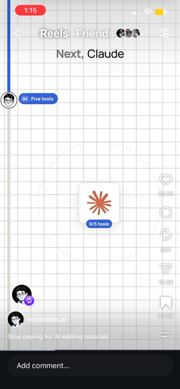 |
| 26 | 프롬프트 «Sent» 카드 | V3 0–0.6 | Raw Footage 폴더 옆에 «PROMPT 03 Edit ✓Sent / Cut dead air, add captions + music, lay it out for review» 카드가 있다. ✓Sent가 초록으로 바뀐다 | 0.1s | 프롬프트 하나를 보냈다 | 상태 텍스트 교체 | 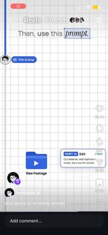 |
| 27 | **아이소 카드 날아들기** | V3 1.1–1.4 | 아이소메트릭 «Video» 카드(아바타 원)가 화면 오른쪽 밖에서 아이소 축(오른쪽 위에서 왼쪽 아래)을 따라 블러와 반투명 상태로 미끄러져 들어와 가운데에 선다 | 0.3s, power3.out | 원본 영상 한 장 | 부모 `transform: rotateX(55deg) rotateZ(-30deg)`, 카드 `from {x:300,opacity:0,filter:blur(6px)}` | 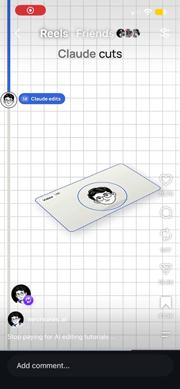 |
| 28 | **아이소 스택 쌓기** | V3 1.5–3.0 | 같은 기울기의 층이 단어에 맞춰 하나씩 위에서 내려와 바로 위 칸에 쌓인다. 순서: «dead air»에 Cuts 층(파란 파형), «captions»에 Captions 층(Cut·the·silence 칩, 눈금), «music»에 Music 층(파란 판과 음표). 새 층은 오른쪽 위 바깥에서 들어오고, 층 사이는 z 간격(약 40px) 오프셋 | 층당 0.25s, power2.out | 편집이 층층이 쌓인다 | 각 층 `from {x:120,y:-120,opacity:0}`, 쌓인 위치는 `translateZ(n*40px)` 또는 y 오프셋 | 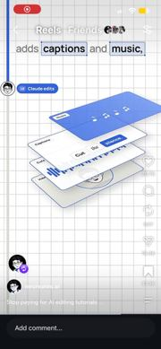 |
| 29 | 스택 푸시인 | V3 3.7–3.95 | 스택 전체가 scale 1→1.15로 다가오며 살짝 위로 간다 | 0.25s, power2.in | 결과로 넘어감 | 부모 scale | 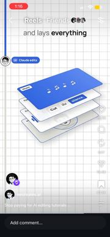 |
| 30 | **스택 평평하게 → 영상 미리보기** | V3 4.0–4.2 | 기울어진 층들이 rotate가 0으로 풀리며 납작한 2D 카드 하나로 합쳐진다. Music 판이 사라지며 «REC 00:04» 영상 프레임(아바타)이 된다. 중간 프레임에서는 층이 반투명하게 겹쳐 보인다 | 0.2s, power3.out | 다 합쳐 한 편의 영상 | 부모 `rotateX/Z → 0`, 층 opacity를 크로스페이드 | 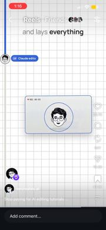 |
| 31 | «Ready for your review» 칩 | V3 4.4–4.6 | 미리보기 아래에 칩이 아래에서 떠오르며 붙는다. REC 타이머가 올라간다 | 0.15s | 검토하면 된다 | `from {y:8,opacity:0}` | 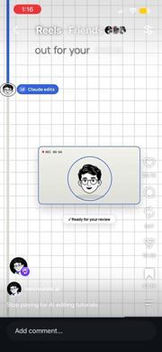 |
| 32 | **THE HOOK 상자 + 음성 파형 칩** | V3 5.1–8.5 | 세로 «THE HOOK» 카드가 블러인으로 들어오고(5.1), «off»에서 THE HOOK 라벨에 테두리 상자가 켜진다(5.8). «like,» 뒤에 카드 오른쪽으로 녹음 칩(빨간 ● + 점선)이 나오고, 파형 막대가 왼쪽에서 오른쪽으로 자란다(7.6–8.3). 녹음이 끝나면 칩 전체가 파란 pill(▶ + 파형)로 바뀌고, 아래에 이탤릭 «"make the hook bigger"» 전사가 붙는다(8.4) | 파형 0.7s linear, 색 바뀜 0.1s | 말로 고친다 | 파형 막대 stagger `scaleY 0→rand`, 칩은 `backgroundColor` 전환 | 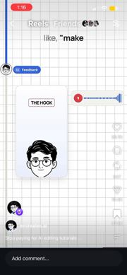 |
| 33 | **HOOK 글자 커짐 + 스파클 + 결과 칩** | V3 8.85–9.3 | «fixes» 단어에서 «THE HOOK» 작은 라벨이 2줄짜리 큰 글자(약 3배)로 한 번에 커진다. 위로 파란 별 2–3개가 튀고, «✱ Fixed. Hook +140% ✓» 영수증 칩이 붙는다 | 0.15s, back.out(2) | 한마디면 고쳐진다 | `fontSize`(또는 scale) tween, 별은 `y:-20, opacity→0` | 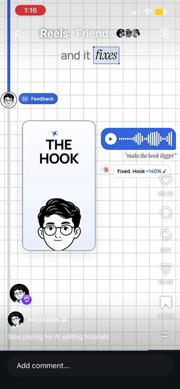 |
| 34 | 블러 디졸브 장면 전환 | V3 9.4–9.6, 15.5 | 이전 장면 전체가 흐려지고 투명해지는 동안 다음 장면(체크리스트)이 흐림에서 선명하게 겹쳐 들어온다. 팬이 아닌 전환은 이것뿐이고, 정리와 CTA 앞에만 쓴다 | 0.2s 겹침, sine.inOut | 장(章)이 바뀐다 | 두 레이어를 반대로 `filter blur + opacity` |  |
| 35 | **체크리스트 캐스케이드** | V3 9.6–12.4 | 13칸 세로 레일(Start · empty folder부터 Finished reel까지)에서 아바타 원이 위에서 아래로 내려간다. 지나가는 칸마다 빈 원이 파란 ✓ 원으로 바뀌고 라벨이 굵어지며, 레일 선이 파랗게 찬다. 자막 «full workflow / from an empty folder / to a finished reel»과 맞춘다 | 칸당 약 0.2s, 일정 속도 | 전 과정을 다 했다 | 칸마다 `addLabel` 후 `.set(check)`, 아바타 y는 linear | 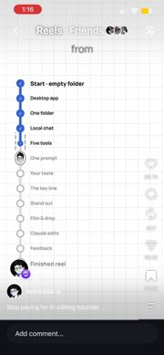 |
| 36 | **폰 카드 팝** | V3 12.4–12.8 | 마지막 «Finished reel»이 체크되는 순간, 오른쪽 아래에 파란 세로 폰 카드(아바타 릴스, 하트·댓글 아이콘)가 약 −12° 기울어진 채 scale 0.5→1로 튀어나온다. 위로 파란 별 스파클이 생기고, 카드가 살짝 흔들리며 위로 떠오른다 | 0.25s, back.out(1.8) + float 0.3s | 완성된 릴스 | `from {scale:.5,rotation:-25,y:40}`, 별 stagger | 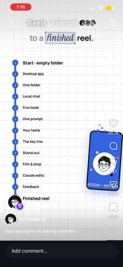 |
| 37 | **TOOLS / YOUR TASTE 카드 갈라짐** | V3 12.9–13.5 | 가운데 아바타 혼자 남은 뒤, 카드 두 장이 아바타 뒤에서 좌우로 벌어지며 나온다(왼쪽 TOOLS, 오른쪽 YOUR TASTE). TOOLS 안에는 도구 아이콘 5개(▶, ‹›, 초록, OpenAI, dlp)가 위에서 아래로 stagger 팝한다. TASTE 안에는 AaAa, 색 점 5개, 곡선이 그려진다 | 카드 0.25s power3.out, 아이콘 0.08s 간격 | 도구와 취향은 다르다 | 카드 `from {x:0,opacity:0}` → `x:±W`, 곡선은 DrawSVG | 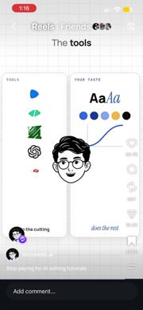 |
| 38 | 가위 절단선 | V3 13.6–13.9 | 가위 ✂ 아이콘이 TOOLS 카드 가운데 높이를 왼쪽에서 오른쪽으로 지나가고, 뒤에 검은 점선이 남는다 | 0.3s, linear | 도구는 자른다 | 가위 `x` tween, 점선은 `scaleX` | 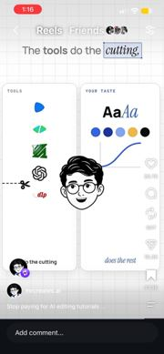 |
| 39 | TASTE 카드 강조 | V3 14.6–15.0 | «taste» 단어에서 YOUR TASTE 카드에 파란 테두리가 켜지고 scale 1→1.04로 살짝 커진다. 모서리에 파란 별 2개가 튀고, TOOLS 카드는 뒤로 밀린다 | 0.2s, back.out | 나머지는 취향이 한다 | `borderColor`, scale, 별 | 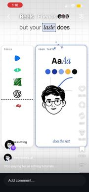 |
| 40 | **CTA 파란 빛 + 아바타 상승** | V3 15.5–16.0 | 블러 디졸브 뒤 바탕 아래쪽이 연파랑 그라디언트 빛으로 바뀌고(아래로 갈수록 진함), 별(✦) 6–8개가 흩어져 천천히 반짝인다. 아바타가 가운데에서 위쪽 1/4 위치로 떠오르며 작아진다 | 0.4s, power2.out, 별 반짝임 1s 주기 | 이제 행동할 차례 | 바탕 `linear-gradient` opacity 0→1, 별은 `opacity yoyo` 랜덤 delay | 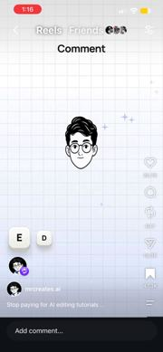 |
| 41 | **글자 타일 떨어지기** | V3 15.6–16.1 | E, D, I, T, O, R 흰 키캡 타일이 위에서 하나씩 떨어져 한 줄로 선다. 동시에 위 댓글 입력칸에 같은 글자가 하나씩 타이핑되고(밑줄 자리 _ _ _), 타이핑된 순서대로 타일이 흰색에서 파란색으로 채워진다 | 타일당 0.08s stagger, bounce.out(작게) | 댓글에 EDITOR라고 써라 | `from {y:-200,opacity:0}` stagger .08, 색은 별도 stagger | 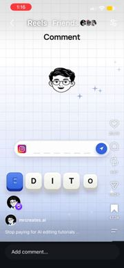 |
| 42 | 보내기 pill → 종이비행기 | V3 16.2–16.6 | 다 친 댓글 입력칸이 파란 pill로 꽉 찬 뒤 오른쪽 원으로 줄어든다. 원이 종이비행기 ✈로 바뀌어 고리 모양 점선 궤적(루프 한 번)을 그리며 위로 날아간다 | 0.5s, 궤적 sine.inOut | 보냈다 | MotionPath 플러그인, 점선은 DrawSVG | 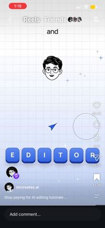 |
| 43 | 타일 무너짐 | V3 16.5–16.7 | 파란 타일 줄이 각자 ±15°로 기울며 아래로 떨어져 화면 밖으로 나간다 | 0.25s, power2.in | 댓글이 처리됐다 | stagger `{y:300,rotation:random(-20,20)}` | 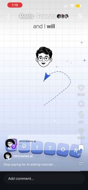 |
| 44 | **DM 알림 + 입력중 점 + 미니 카드** | V3 16.6–17.8 | 인스타 DM 알림 카드(mrcreates.ai)가 아래에서 올라온다. 처음엔 «•••» 입력중 점, 다음엔 «sent you all 3 prompts ✨»로 바뀌고, 빨간 «1» 배지가 pop한다. 오른쪽에 미니 프롬프트 카드 01, 02, 03이 «all three prompts»에 맞춰 하나씩 겹쳐 붙는다. 끝에 흐려지며 사라진다 | 카드 0.25s power3.out, 미니 카드 0.15s 간격 | DM으로 바로 받는다 | 텍스트 교체 타임라인, 배지 back.out(3) | 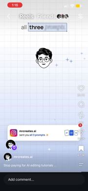 |
| 45 | 팔로우 아바타 원 마스크 | V3 18.0–18.7 | 아바타가 흰 원 마스크 안에 들어가고, 아래에서 분홍 호(스토리 링처럼)가 그려진다. 커서 «\|» 같은 세로 막대도 나온다. 인스타 UI와 겹쳐 있어 일부는 확인 안 됨 | 0.3s | 팔로우하라 | `clip-path circle` + `strokeDashoffset` | 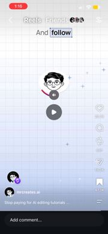 |
| 46 | 해시태그 빨간 취소선 | V4 0.3–0.6 | 아바타 주변에 떠 있던 #reels, #viral, #fyp, #explore, #instagood, #trending pill 6개에 «hashtags» 단어와 동시에 빨간 취소선이 그어지고, 글자도 빨갛게 바뀐다 | 0.2s, 6개가 거의 동시 | 해시태그는 소용없다 | `::after scaleX`, stagger 0.03 |  |
| 47 | 해시태그 흩어져 떨어짐 | V4 0.8–1.4 | 각 pill이 바깥쪽으로 조금 퍼지며(±15° 회전) 아래로 떨어지고, 흐려지고 투명해진다 | 0.5s, power2.in | 버린다 | stagger random `{y:+400,x:±40,rotation,filter:blur(4px),opacity:0}` |  |
| 48 | 조회수 카운터 칩 | V4 1.2–2.3 | 아바타 아래에 파란 «▲ 1,204 views» 칩이 작게 팝한 뒤 커지면서 숫자가 11,339, 27,930, 38,602, 44,663, 47,416, 48,167, 48,200 순으로 감속하며 멈춘다. 2.3s에 흐려지며 사라진다 | 0.8s, expo.out | 이걸 하면 조회수가 뛴다 | `gsap.to(o,{v:48200,ease:'expo.out',snap:1})`, 칩 scale .6→1 | 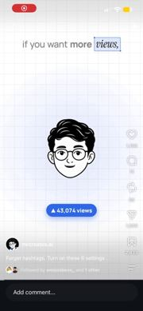 |
| 49 | 토글 6개 차례로 켜짐 | V4 2.4–2.9 | 토글 6개가 회색 OFF로 하나씩 나타나고, «six settings»에서 왼쪽부터 파란 ON으로 물결처럼 켜진다 | 등장 0.05s 간격, 켜짐 0.06s 간격 | 설정 여섯 개 | 두 개의 stagger(`opacity`, `.on` class) | 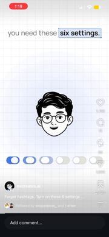 |
| 50 | **토글 → 상단 진행 트레이로 날아감 + 아바타 배지화** | V4 3.0–3.6 | 아바타가 줄며 파란 테두리 원 배지가 되어 위로 올라간다. 토글 6개는 아래에서 위로 비스듬한 호를 그리며 차례로 날아가 맨 위 «1/6» 진행 pill 안의 작은 토글 칸으로 빨려 들어간다. 첫 칸만 켜진 상태 | 0.6s, 토글 stagger 0.06, power2.inOut | 여섯 개 중 1번부터 | FLIP: 토글 위치를 트레이 칸 rect로 tween, 아바타 `scale .55, y` | 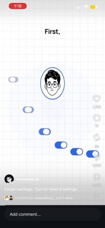 |
| 51 | **아바타 부채꼴 선 + 사람 아이콘 + 패킷** | V4 4.2–4.9 | 배지 아래 한 점에서 파란 점선이 반시계 방향으로 하나씩 그려지며 부채꼴(약 160°, 12갈래)로 퍼진다. 선 끝에 사람 아이콘 원이 하나씩 팝하고, 선 위로 작은 파란 사각 패킷이 바깥으로 흘러간다 | 선당 0.05s stagger, 각 0.2s power1.out, 패킷은 반복 | 내 영상이 새 사람에게 퍼진다 | SVG line `strokeDashoffset` stagger, 사람 `from {scale:0}`, 패킷은 MotionPath repeat | 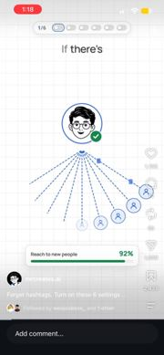 |
| 52 | 상태 배지 ✓ → ! | V4 4.1 → 4.9 | 아바타 배지 오른쪽 아래의 초록 ✓가 «problem» 단어에서 주황 «!»로 바뀐다 | 0.1s 바로 바뀜 | 계정에 문제가 있다 | 아이콘과 색 set + scale 펄스 | 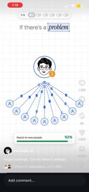 |
| 53 | **도달 막대 92→4% + 선 꺼짐** | V4 6.0–7.7 | 아래 «Reach to new people» 카드의 막대가 줄어든다(숫자는 위 목록). 색은 초록에서 주황, 빨강 순으로 바뀐다. 동시에 부채꼴 선과 사람 아이콘이 바깥쪽부터 회색으로 흐려지고, 패킷이 멈추며, 마지막엔 가운데 한 갈래만 남았다가 그것도 꺼진다 | 1.7s, 처음 느리다가 빨라지고(power2.in) 끝은 감속 | 인스타가 조용히 노출을 끊는다 | 막대 `width` tween + `color` 보간, 선은 index 역순 stagger `opacity .25, stroke grey` | 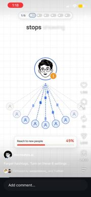 |
| 54 | 부드러운 방사형 빛 | V4 0–2.4 (V3 CTA와 같은 계열) | 아바타 뒤에 연파랑 원형 빛(반경은 화면 폭의 약 0.6)이 깔린다. 밝기가 아주 약하게 숨쉬듯 변한다 | 2s 주기, sine.inOut yoyo | 주인공 강조 | `radial-gradient` div의 opacity와 scale을 yoyo | 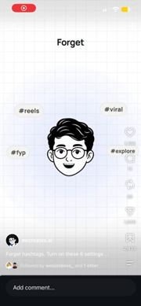 |

## 공통 바탕

흰 모눈(약 24px 격자, 연회색). 왼쪽 세로 레일과 단계 칩(«0N 이름», 파란 pill)이 늘 화면에 있다. PNG 5645에는 레일 대신 위쪽 3칸 진행 막대(01 FIND · 02 PLACE · 03 CHECK)를 쓴 변형이 있다. PNG 5644의 «Claude without» 선택 상자에는 피그마식 모서리 핸들이 보인다(효과 2의 변형).

## 속도 메모

1. 자막은 한 줄에 1–4단어이고, 말하는 속도대로 초당 약 3–4단어가 블러인으로 들어온다. 핵심어 하나에만 0.1s 늦게 선택 상자가 켜지고, 줄이 끝나면 0.1–0.2s 동안 흐려지며 사라진다.
2. 그림 쪽 변화는 0.5–0.8s마다 하나씩 온다. 거의 모든 움직임이 핵심어가 나오는 프레임에 맞춰 시작한다(price는 빨강, local은 토글, fixes는 HOOK 커짐, problem은 배지 !).
3. 단계 사이는 컷 없이 0.4–0.5s 세로 카메라 팬과 레일 위 아바타 하강으로 이어지고, 블러 디졸브는 정리와 CTA 같은 장 전환에만 쓴다. 한 단계는 대략 3–5s.
